* Table of Contents
{:toc}

--------------------------------------------------------------------------------------------------------------------

## **Acknowledgements**

* This project is based on the AddressBook-Level3 project created by the [SE-EDU initiative](https://se-education.org).

--------------------------------------------------------------------------------------------------------------------

## **Setting up, getting started**

Refer to the guide [_Setting up and getting started_](SettingUp.md).

--------------------------------------------------------------------------------------------------------------------

## **Design**

:bulb: **Tip:** The `.puml` files used to create diagrams are in `docs/diagrams`. Refer to the [_PlantUML Tutorial_ at se-edu/guides](https://se-education.org/guides/tutorials/plantUml.html) to learn how to create and edit diagrams.

### Architecture

The ***Architecture Diagram*** given above explains the high-level design of the App.

The following provides a quick overview of the main components and their interactions.

**Main components of the architecture**

**`Main`** (consisting of classes [`Main`](https://github.com/AY2627S1-CS2103T-T09-1/tp/tree/master/src/main/java/seedu/address/Main.java) and [`MainApp`](https://github.com/AY2627S1-CS2103T-T09-1/tp/tree/master/src/main/java/seedu/address/MainApp.java)) is in charge of the app launch and shut down.
* At app launch, it initializes the other components in the correct sequence, and connects them up with each other.
* At shut down, it shuts down the other components and invokes cleanup methods where necessary.

The bulk of the app's work is done by the following four components:

* [**`UI`**](#ui-component): The UI of the App.
* [**`Logic`**](#logic-component): The command executor.
* [**`Model`**](#model-component): Holds the data of the App in memory.
* [**`Storage`**](#storage-component): Reads data from, and writes data to, the hard disk.

[**`Commons`**](#common-classes) represents a collection of classes used by multiple other components.

**How the architecture components interact with each other**

The *Sequence Diagram* below shows how the components interact with each other for the scenario where the user issues the command `delete 1`.

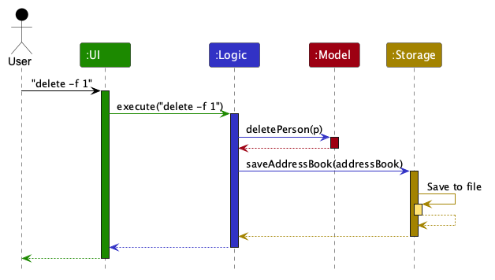

Each of the four main components (also shown in the diagram above),

* defines its *API* in an `interface` with the same name as the Component.
* provides its functionality through a concrete `{Component Name}Manager` class that implements the corresponding API interface.

For example, the `Logic` component defines its API in `Logic.java` and implements it in `LogicManager.java`. Other components interact with a component through its interface rather than its concrete class, preventing them from coupling to that component's implementation, as illustrated in the following partial class diagram.

The sections below give more details of each component.

### UI component

The **API** of this component is specified in [`Ui.java`](https://github.com/AY2627S1-CS2103T-T09-1/tp/tree/master/src/main/java/seedu/address/ui/Ui.java)

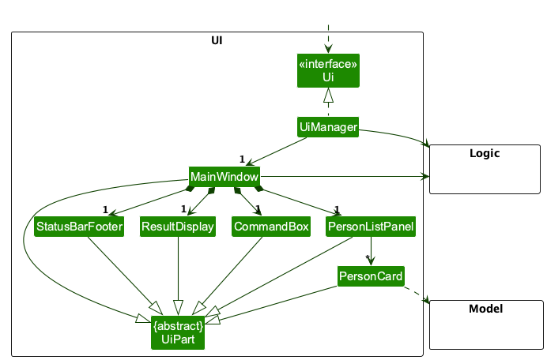

The UI consists of a `MainWindow` and its parts, such as `CommandBox`, `ResultDisplay`, `PersonListPanel`, `StudentDetailPanel`, and `StatusBarFooter`. `MainWindow` replaces the list panel with a student detail panel when a `view` command succeeds, so only one main content panel is visible at a time. All of these classes inherit from the abstract `UiPart` class, which captures common behavior among classes that represent visible GUI parts.

The `UI` component uses the JavaFX UI framework. The layouts of these UI parts are defined in matching `.fxml` files in `src/main/resources/view`. For example, [`MainWindow.fxml`](https://github.com/AY2627S1-CS2103T-T09-1/tp/tree/master/src/main/resources/view/MainWindow.fxml) specifies the layout of [`MainWindow`](https://github.com/AY2627S1-CS2103T-T09-1/tp/tree/master/src/main/java/seedu/address/ui/MainWindow.java).

The `UI` component,

* executes user commands using the `Logic` component.
* listens for changes to `Model` data so that the UI can be updated with the modified data.
* keeps a reference to the `Logic` component, because the `UI` relies on the `Logic` to execute commands.
* depends on some classes in the `Model` component because it displays `Person` objects from the model.

### Logic component

**API** : [`Logic.java`](https://github.com/AY2627S1-CS2103T-T09-1/tp/tree/master/src/main/java/seedu/address/logic/Logic.java)

Here's a (partial) class diagram of the `Logic` component:

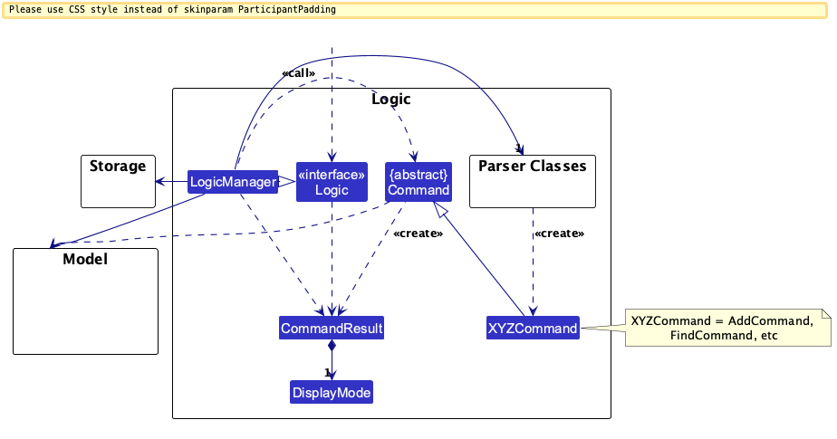

The sequence diagram below illustrates the interactions within the `Logic` component, taking `execute("delete -f 1")` API call as an example.

:information_source: **Note:** The lifeline for `DeleteCommandParser` should end at the destroy marker (X), but due to a limitation of PlantUML, it extends slightly past the center of the marker.

How the `Logic` component works:

1. When `Logic` is called upon to execute a command, the command is passed to an `AddressBookParser` object, which in turn creates a parser that matches the command (e.g., `DeleteCommandParser`) and uses it to parse the command.
1. This results in a `Command` object (more precisely, an object of one of its subclasses e.g., `DeleteCommand`) which is executed by the `LogicManager`.
1. The command can communicate with the `Model` when it is executed (e.g. to delete a person). 
   Note that although this is shown as a single step in the diagram above for simplicity, the code can require several interactions between the command object and the `Model` to complete the operation.
1. The result of the command execution is encapsulated as a `CommandResult` object which is returned from `Logic`.

Here are the other classes in `Logic` (omitted from the class diagram above) that are used for parsing a user command:

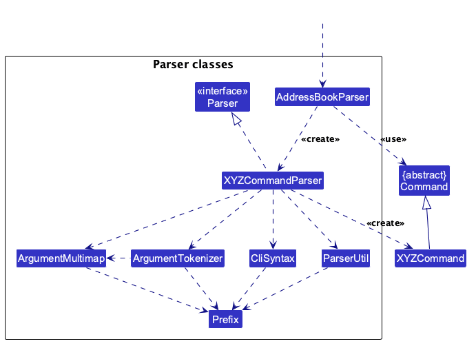

How the parsing works:
* Before parsing, `AddressBookParser` passes the user command through `StringUtil#normalizeInput`. It turns every kind of whitespace, such as a non-breaking space, into a normal space and removes invisible characters, such as a zero-width space. Pasted text is then parsed the same way as typed text, so a prefix after a non-breaking space is still recognized.
* When called upon to parse a user command, the `AddressBookParser` class creates an `XYZCommandParser` (`XYZ` is a placeholder for the specific command name, e.g., `AddCommandParser`). The parser uses the other classes shown above to parse the user command and create an `XYZCommand` object (e.g., `AddCommand`). The `AddressBookParser` returns that object as a `Command` object.
* All `XYZCommandParser` classes, such as `AddCommandParser` and `DeleteCommandParser`, implement the `Parser` interface so they can be treated similarly where appropriate, for example during testing.

### Model component
**API** : [`Model.java`](https://github.com/AY2627S1-CS2103T-T09-1/tp/tree/master/src/main/java/seedu/address/model/Model.java)

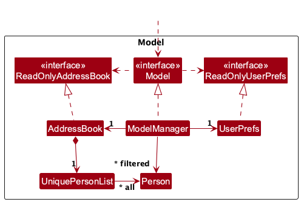

The `Model` component,

* stores the address book data i.e., all `Person` objects (which are contained in a `UniquePersonList` object).
* stores the `Person` objects selected by the current filter, such as search results, in a separate _filtered_ list. It exposes this list as an unmodifiable `ObservableList<Person>` that the UI can observe and bind to, so the UI updates when the list changes.
* stores a `UserPrefs` object that represents the user’s preferences (currently, just the GUI settings). This is exposed to the outside as a `ReadOnlyUserPrefs` object.
* does not depend on any of the other three components (as the `Model` represents data entities of the domain, they should make sense on their own without depending on other components)

Each `Person` is one student. The classes that make up a `Person` are shown below.

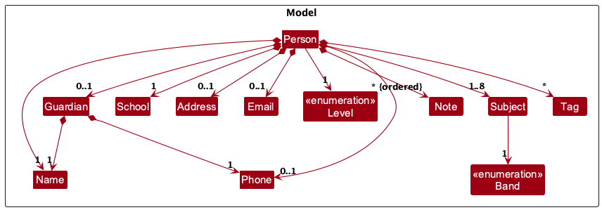

The diagram does not show these rules, which the classes check when an object is created:

* A student has 1 to 8 subjects, and no two of them have the same name, ignoring case. `Person#validateSubjects` checks both, so the same subject cannot be taken at two bands.
* A note's NID is its position in the student's list of notes. A new note goes at the end, and deleting a note renumbers the notes after it.
* A `Guardian` always has both a name and a phone. A student has a complete guardian or none. See [Guardian details](#guardian-details).
* `Guardian` reuses `Name` and `Phone`, so a guardian's name and phone follow the same rules as a student's.

### Storage component

**API** : [`Storage.java`](https://github.com/AY2627S1-CS2103T-T09-1/tp/tree/master/src/main/java/seedu/address/storage/Storage.java)

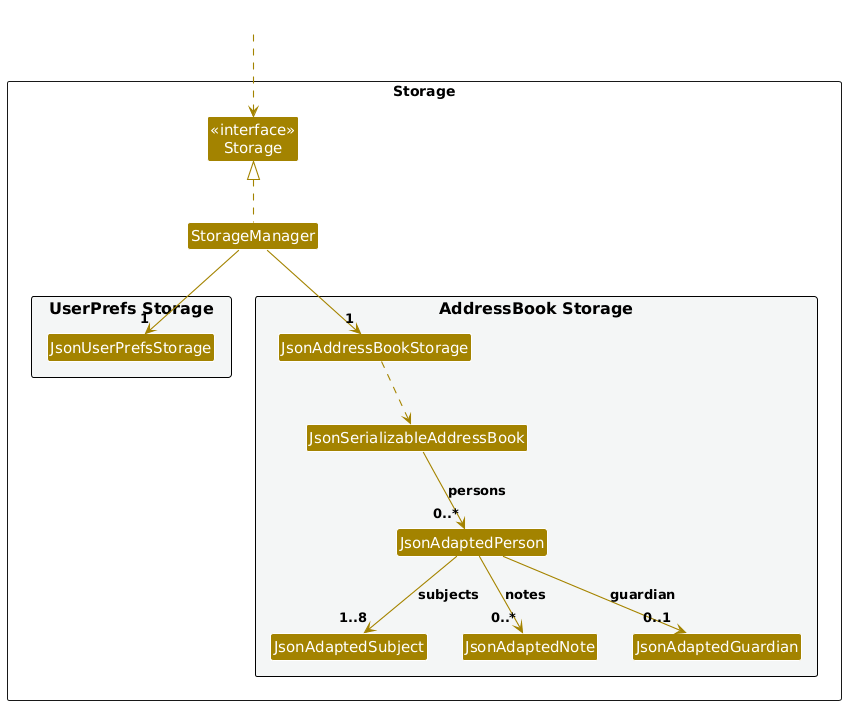

The `Storage` component,
* can save both address book data and user preference data in JSON format, and read them back into corresponding objects.
* is implemented by `StorageManager`, which delegates the actual JSON file access to `JsonAddressBookStorage` and `JsonUserPrefsStorage` (one class per data file).
* depends on some classes in the `Model` component (because the `Storage` component's job is to save/retrieve objects that belong to the `Model`)

### Common classes

Classes used by multiple components are in the `seedu.address.commons` package.

--------------------------------------------------------------------------------------------------------------------

## **Implementation**

This section describes some noteworthy details on how certain features are implemented.

### Viewing student details

The `view INDEX` command passes the selected student from `Logic` to the detail panel without storing UI state in the `Model`.

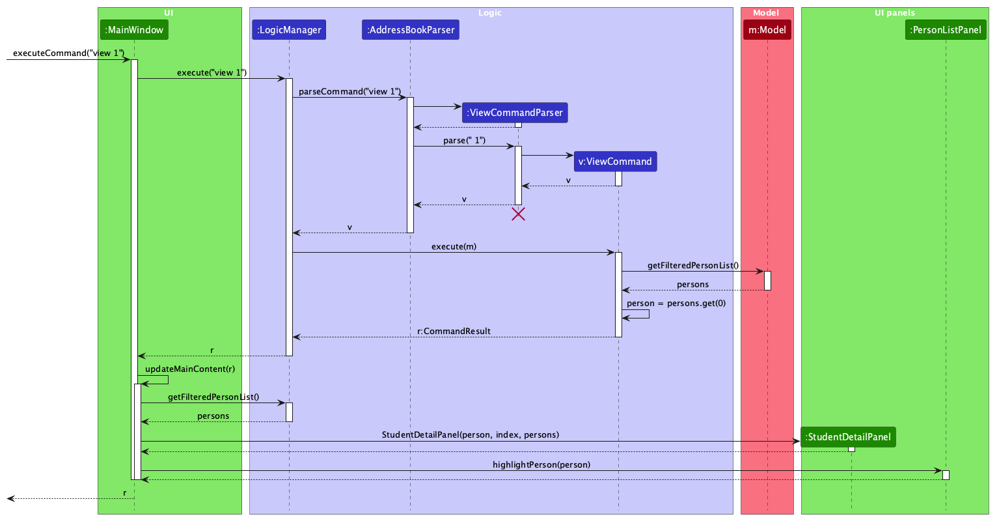

:information_source: **Note:** The lifeline for `ViewCommandParser` should end at the destroy marker (X), but due to a limitation of PlantUML, it extends slightly past the center of the marker.

The diagram omits the routine `Storage#saveAddressBook` call that `LogicManager` makes after command execution. The `view` command does not change the data being saved.

1. `AddressBookParser` delegates the index argument to `ViewCommandParser`, which creates a `ViewCommand`.
1. `ViewCommand#execute` reads the current filtered student list from the `Model`. It validates the displayed index and obtains the student at that position. An out-of-range index throws a `CommandException`, so `MainWindow` does not replace the current detail panel.
1. For a valid index, `ViewCommand` returns a `CommandResult` containing `DisplayMode.SHOW_STUDENT`, the selected `Person`, and the displayed index. The command does not modify the `Model`.
1. `MainWindow#updateMainContent` handles `SHOW_STUDENT` by creating a `StudentDetailPanel` with the selected student, index, and current filtered list. It replaces the content of the detail placeholder with the new panel and asks `PersonListPanel` to highlight and scroll to the same student.

The `StudentDetailPanel` places the student's details and notes in one vertical scroll pane. It listens to the filtered list and refreshes the record at the displayed index when that list changes. This allows edits to update an open detail panel while keeping the command's displayed index consistent with the list.

### Student duplicate handling

The app compares a student's normalized name, school, and level as the strict duplicate key. Name comparison trims surrounding spaces, collapses repeated spaces, and ignores case. School comparison uses the same case- and space-insensitive behavior. Levels are compared by their `Level` values. The original text remains available for display. Phone, subject, and band do not contribute to the key.

`AddCommand` and `EditCommand` first reject an exact key collision with command-specific error text, which `MainWindow` displays in red. The errors recommend adding a distinguishing identifier to the saved name (for example, `Chloe Tan 2`) when the records are different people; otherwise, identical name, school, and level values would make the students indistinguishable in the app. If only the normalized name matches, the commands request confirmation with command-specific prompt text, displayed in amber. Each matching school and level pair is separated by a semicolon so commas inside school names remain unambiguous. Each command also supplies an action-specific instruction on a separate line, followed by the shared cancellation guidance. On confirmation, they recheck the exact key before changing the model. For an edit, the record being edited is excluded from both checks; edits that leave name, school, and level unchanged do not prompt. This prevents a prompt against itself or an unrelated phone, subject, or note change, and prevents a confirmed operation from bypassing the model's invariant.

The model enforces the strict key through `UniquePersonList` for adds, replacements, and bulk resets. JSON loading uses the same check, so same-name records with different schools or levels load, while strict duplicates are rejected. `addnote` and `deletenote` replace a person without changing the key and remain valid. Delete and clear only remove records. Delete and delete-note prompts and feedback include school and level to distinguish same-name students. Sample data enters through the same model list and is subject to the same rule.

#### Design considerations

**Aspect: Which student records count as duplicates**

* **Alternative 1: Reject every same-name record.**
  * Pros: Simple rule, simple model invariant, and a same-name record cannot be added accidentally.
  * Cons: Blocks legitimate students who share a name, including siblings or students at different schools or levels. It provides no way to keep both records.

* **Alternative 2: Allow all duplicates.**
  * Pros: Never blocks a legitimate enrollment, and the data model stays flexible.
  * Cons: A repeated command can silently create indistinguishable records. Tutors can select or edit the wrong student, and the app offers no protection against accidental duplicate records.

* **Alternative 3 (chosen): Allow same-name records only when school or level differs; reject a repeated normalized name, school, and level.**
  * Pros: Supports real students who share a name while blocking the most likely accidental repeat. An amber prompt handles uncertain same-name matches, and the hard model rule prevents an exact key duplicate through add, edit, or data loading. The three fields are required for every student and together distinguish a student's current school-level record better than name alone.
  * Cons: Two different students with the same name at the same school and level cannot both be entered under identical details, because TuteeBook would display them as indistinguishable records and the tutor could select or change the wrong one. The red add/edit error recommends assigning one a distinguishing saved name, such as `Chloe Tan 2`. A student moving to another school or level can be represented by an updated record, but the app does not retain two concurrent records with the same key. Name-only matching can also prompt for unrelated students.

The required subject and band are deliberately excluded from the key. A student can take several subjects and bands, and that list changes as lessons and courses change; using it would allow the same student to be added again merely by changing a subject or band. Subject-band details describe the student's studies, not who the student is. The phone is also excluded because it is optional, can change, and may be shared or unavailable.

Every student record must include a name, school, and level. Many tutors teach students with common names. School helps distinguish students who attend different schools. Level helps distinguish students at the same school who are in different levels. These fields block many accidental repeat entries while still allowing students with the same name when their school or level differs.

### Student names and schools

`Name` and `School` both use English letters and digits, so neither accepts other Unicode letters or numbers. A name starts with an English letter or digit and can contain only English letters, digits, and spaces; guardian names use the same rule. A school name must be 1 to 100 characters, contain at least one English letter, and can also contain spaces, periods, apostrophes (`'` or `’`), ampersands, parentheses, commas, and hyphens. Names and schools therefore share a letter and digit rule while retaining different punctuation rules for their fields. The parsers trim and collapse ordinary spaces before constructing these values. Direct model construction and JSON loading use the same validators.

The letter and digit rule also applies to existing data files. A file containing a name or school with any other letters or numbers fails validation when loaded, with the relevant field constraint. Users must edit those records in the previous version before upgrading. Previously supported school punctuation remains valid.

`Note` text uses the same English-letter approach, so an accented letter is rejected in a note just as it is in a name or school. A note can contain 1 to 500 English letters, digits, spaces, and keyboard symbols (together, the printable ASCII range `\x20` to `\x7E`), because notes record scores and reminders such as `WA2 Math: 36/50`. It also accepts the curly apostrophe `’`, as `School` does, so `Didn’t finish` is not rejected in a note when `St. Joseph’s Institution` is accepted as a school. For any other character, `Note#getConstraintMessage` names the first one, and returns an emoji whole rather than half of its UTF-16 pair. `ParserUtil#parseNote` (used by `addnote` and `editnote`) and `JsonAdaptedNote` both use this message. `filter note/` search text is not restricted, like `n/` and `sch/` search text. A data file containing a note with any other character fails validation when loaded, so users must edit those notes in the previous version before upgrading.

`Address` accepts the same characters as `Note`, because addresses also need keyboard symbols such as `#`, `/`, and `,`, as in `Blk 123 Bedok North Ave 2, #04-111`. It declares its own copy of the allowed-character regex, as every field class owns its rules. `Address#getConstraintMessage` names the first character that isn't allowed, like `Note#getConstraintMessage`, and is used by the `Address` constructor, `ParserUtil#parseAddress` (used by `add` and `edit`), and `JsonAdaptedPerson`. Blank and too-long addresses keep the existing `Address.MESSAGE_CONSTRAINTS`. `filter a/` search text is not restricted. A data file containing an address with any other character fails validation when loaded, so users must edit those addresses in the previous version before upgrading.

`Address`, `Note`, `Phone`, and `Email` find the first character that isn't allowed with `StringUtil#findInvalidCharacter`, passing their own allowed-character regex. It returns an emoji whole rather than half of its UTF-16 pair.

#### Design considerations

**Aspect: Character rules for names and schools**

* **Alternative 1: Allow Unicode letters and digits in both fields.**
  * Pros: Preserves names and school names in their original writing systems and supports accented spellings.
  * Cons: Does not match the User Guide's definitions of English letters (`A`–`Z`, `a`–`z`) and digits (`0`–`9`). Names and schools would also continue to accept different character sets if their punctuation rules differ.

* **Alternative 2: Use the same strict English letters, digits, and spaces rule for both fields.**
  * Pros: Gives both fields exactly the same simple validation rule.
  * Cons: Rejects common official school-name punctuation such as periods, apostrophes, ampersands, parentheses, commas, and hyphens. Existing school records using that punctuation would fail to load.

* **Alternative 3 (chosen): Require English letters and digits in both fields, while retaining school-specific punctuation.**
  * Pros: Rejects other letters consistently, preserves real school formats such as `Anglo-Chinese School (Independent)` and `St. Joseph's Institution`, and keeps parser, model, and storage validation aligned.
  * Cons: Names and schools still have different punctuation rules, which must be documented. Accented letters and letters from other alphabets are rejected in either field, so existing records with them must be changed before upgrading.

The third option was selected because the issue was inconsistent handling of letters, not a need to make names and school names use identical punctuation. Allowing only English letters and digits rejects the accented school case consistently with student names, while keeping the punctuation needed for realistic school names. The User Guide lists the exact rules for each field and explains the existing-data limitation.

### School validation and error messages

`ParserUtil#parseSchool` trims and collapses repeated spaces, then calls `School#getInvalidReason`, which returns a targeted message for the first problem found, in this order: blank input, more than 100 characters, the first unsupported character, then no English letter. `School#isValidSchool` uses the same checks, so `add`, `edit`, model construction, and JSON loading apply the same rules. The model and JSON adapter report the general `School.MESSAGE_CONSTRAINTS` instead of a targeted message.

### Student subjects and bands

Each student has 1 to 8 subjects. Every subject has a name and one band: `G1`, `G2`, or `G3`. Subject names can contain 1 to 40 English letters, spaces, hyphens, parentheses, commas, and ampersands, and must contain at least one letter. Digits, slashes, other letters, and other symbols are rejected. Subject names use English letters for the same reason as names and schools, as explained in [Student names and schools](#student-names-and-schools), so the same accented letter is handled the same way in every student field. A data file containing a subject name with any other letters fails validation when loaded, with the subject constraint. Users must edit those subjects in the previous version before upgrading. A student cannot have the same subject name more than once, even at different bands.

`Subject` is an immutable value object containing both the subject name and its required `Band`. The band is an enum, so a `Subject` cannot be constructed with an unsupported band or without one. For comparison, `Subject` trims surrounding spaces, collapses repeated ordinary spaces, and lowercases the name. The band is included in `Subject.equals`, but `Person#validateSubjects` checks names separately and rejects a repeated subject even if the bands differ.

#### Implementation

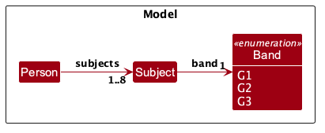

1. `AddCommandParser` and `EditCommandParser` tokenize `sub/` and `band/`. `ArgumentMultimap#verifyEachFollowedBy` checks that each `sub/` is immediately followed by one `band/`. `add` requires at least one pair. For `edit`, giving neither prefix leaves the subjects unchanged; giving either prefix requires complete pairs and replaces the subject list.
1. `ParserUtil#parseSubjects` checks that the subject-name and band lists have the same number of values and that there are no more than eight pairs. It creates each `Subject` from the name and band at the same position, then calls `Person#validateSubjects` to reject repeated names.
1. `Band#fromString` converts the supplied value to the matching enum, ignoring case and surrounding spaces. `Subject` validates its name and requires a non-null band. These checks also apply when a subject is constructed outside the command parsers.
1. `JsonAdaptedSubject` stores a subject as a JSON object with `name` and `band` fields. During loading, it validates both fields and converts the band back to the enum. `Person` then validates the full subject list, so missing, invalid, or repeated subject data is rejected.
1. The detail panel and command result display each subject with its band, such as `Mathematics (G1)`. `filter sub/Mathematics band/G1` matches a student only when that student has Mathematics at G1; omitting `band/` matches the subject at any band.

#### Design considerations

**Aspect: Whether to store a band for each subject**

* **Alternative 1: Store subjects without bands.**
  * Pros: Keeps each subject entry simple and does not require the tutor to know or enter a band.
  * Cons: The tutor cannot record or filter by the level at which a student takes each subject, even though students may take different subjects at different bands.

* **Alternative 2 (current choice): Store a subject and a required band together.**
  * Pros: Every recorded subject has complete information. The model prevents a subject from existing without a valid band, and `filter` can match a subject at a specific band.
  * Cons: The tutor cannot record a subject until they know its band.

* **Alternative 3: Store a subject with an optional band.**
  * Pros: Allows the tutor to record a subject before its band is known.
  * Cons: Adds a second state for every subject and requires commands, storage, and display to handle missing bands. Filtering by band must also distinguish between “any band” and “no band recorded.”

The app uses the second option because the tutor needs each subject’s band to plan lessons at the right level. Requiring it when the subject is entered keeps the model and stored data consistent. The pair format also makes the relationship explicit in commands: each `sub/` must be followed by its own `band/`.

**Aspect: Which characters to allow in subject names**

* **Alternative 1:** Keep the existing letters, spaces, and hyphens.
  * Pros: Keeps validation simple and rejects punctuation that may be accidental.
  * Cons: Rejects commonly used subject names such as `Science (Physics, Chemistry)` and `Design & Technology`.

* **Alternative 2 (current choice):** Also allow parentheses, commas, and ampersands.
  * Pros: Accepts the real names reported in issue 263 while retaining the existing length limit and at-least-one-letter rule. Digits, slashes, and other symbols remain rejected.
  * Cons: A subject can contain awkward punctuation placement because the rule checks allowed characters, not subject-name grammar.

* **Alternative 3:** Allow any printable punctuation and digits.
  * Pros: Supports a wider range of current and future course names.
  * Cons: Allows more accidental or inconsistent names than the issue requires, which can make subjects harder to recognize and filter consistently.

The app uses the second option because it resolves the reported real-name cases without making subject names unrestricted. The subject name remains one value before `band/`; the added characters do not change command tokenization.

### Student addresses

`Address` is an optional value object. It accepts any nonblank value up to 200 characters and collapses repeated ordinary spaces. The add parser accepts optional `a/ADDRESS`; the edit parser replaces an address, and a blank `a/` removes it. `JsonAdaptedPerson` saves supplied addresses and accepts older JSON records without an address. The student list card shows an address when one is present; the detail panel and command result show `Not provided` when it is absent. Addresses do not contribute to duplicate detection.

### Student emails

`Email` is an optional value object that follows the same pattern as `Address`. `Email#isValidEmail` accepts a value of the form `local-part@domain` that is at most 254 characters, the longest address that SMTP allows (RFC 5321):

* The local part is groups of English letters and digits joined by single `+`, `_`, `.`, or `-` characters, so it cannot start or end with a symbol or contain two symbols in a row.
* The domain is labels joined by single periods. Each label is groups of letters and digits joined by single hyphens, and the last label has at least 2 characters.
* `ParserUtil#parseEmail` trims the value before validating it, so only a space inside the email is rejected.

`Email.MESSAGE_CONSTRAINTS` lists every rule in one message. Separate messages for each failure, such as a missing `@`, are left for a later version.

The add parser accepts optional `e/EMAIL`; the edit parser replaces an email, and a blank `e/` removes it. `JsonAdaptedPerson` leaves `email` out of the file when a student has none, and Jackson sets the field directly, so files without an email still load. Emails do not contribute to duplicate detection.

A domain with no period, such as `john@gmail`, is valid (`localhost` is a real domain) but is almost always a missing `.com`. Rejecting it would block valid addresses, so `AddCommand` and `EditCommand` save it and add a warning instead, the same way as for phones (see [Phone number validation](#phone-number-validation)). `Email#hasDotInDomain` does the check, and `Messages#getEmailNoDomainDotWarning` builds the warning. `EditCommand` only checks an email typed in that command.

### Student tags

A student has a set of `Tag`s, which may be empty but is never null. `Person#getTags()` returns an unmodifiable view that keeps the order the tags were typed in.

* A tag is one word of English letters and digits, where single hyphens may join parts of the word, such as `O-level`. `Tag` compares tags ignoring case, so `Exams` equals `exams`, and the display keeps the user's capitalization.
* `ParserUtil#parseTag` trims the value, then rejects a value containing a space with its own message, `Messages.MESSAGE_TAG_HAS_SPACE`, which tells the user to put `t/` before each tag (`filter` uses its own message, since it takes one tag). Other invalid values get `Tag.MESSAGE_CONSTRAINTS`. The space message lives in `Messages` because it names the `t/` prefix, which the model should not know about.
* `ParserUtil#parseTags` rejects a tag given twice with `Tag "X" is given more than once.`, instead of letting the set drop it silently. It takes plain strings, so the prefix handling stays in the parsers.
* In `add`, `t/` may repeat. In `edit`, the given tags replace all existing tags, and a single blank `t/` clears them. `EditCommandParser#parseTagsForEdit` handles both cases.
* `JsonAdaptedPerson` stores tags as a list of `JsonAdaptedTag` strings. Jackson sets the list directly, so files saved before tags existed load with no tags. A file with an invalid or repeated tag is rejected.
* Tags do not contribute to duplicate detection.

Tags are one word, so that they are quick to type and to filter by. Hyphens are allowed because realistic tags such as `O-level` and `N-level` contain them. This means `exam-prep` and `examprep` are different tags, which the User Guide states. Spaces are not allowed, because they would add a third spelling, `exam prep`, and because rejecting a space catches a common mistake: `t/paid urgent`, where the user forgot the second `t/`, is rejected with a message that explains how to give two tags, instead of being saved as one tag.

### Command confirmations

`ClearCommand`, `DeleteCommand`, and `DeleteNoteCommand` implement `ConfirmationCommand`. Before running one of these commands, `LogicManager` asks it whether a prompt is needed. `ConfirmationManager` stores the command and returns a warning `CommandResult`, which the UI displays in amber. The prompt states that the action is pending, puts the action-specific confirmation instruction on a new line, and displays shared cancellation guidance on another line. The next input confirms the stored command only when trimming leading and trailing spaces produces the exact uppercase word `CONFIRM`. Every other input first clears the pending command, then follows normal command parsing and execution. A red cancellation notice is displayed above the new command's unchanged output; if parsing or execution fails, the cancellation notice and error are both red. If the new command needs confirmation, it replaces the old request. When no command is pending, `LogicManager` rejects the exact word `CONFIRM` before parsing, with `MESSAGE_NOTHING_TO_CONFIRM`, so a user who confirms after a request was cancelled learns that nothing changed instead of seeing `Unknown command.` These destructive commands accept `-f` to execute without prompting.

The `delete`, `deletenote`, and `clear` prompts state the consequence directly (for example, `This will delete ...`). The `add` and `edit` prompts instead say that the record has not yet been added or saved, so it is clear that a name-match warning has not already carried out the action.

#### Design considerations

**Aspect: How the user confirms a destructive command**

* **Alternative 1:** Ask for `y` or `n`.
  * Pros: Fast to type and familiar to many command-line users.
  * Cons: A one-letter response is easy to enter accidentally. If other input is blocked while the prompt is pending, the user must enter `n` before they can run a command such as `list` to check an index. If other input runs as a command, `y` and `n` become reserved responses that cannot be used as command names during that prompt.

* **Alternative 2:** Ask for `yes` or `no`.
  * Pros: The response is more explicit than a single letter and reads naturally in a prompt.
  * Cons: Accepting both `y`/`n` and `yes`/`no` adds four confirmation spellings to remember and test. Accepting only `yes`/`no` still reserves those inputs while a prompt is pending.

* **Alternative 3 (current choice):** Ask the user to type the exact uppercase word `CONFIRM`; trim leading and trailing spaces before comparing.
  * Pros: The word makes the destructive intent explicit and is less likely to be entered accidentally. Lowercase `confirm`, `CONFIRM extra`, and `y` do not confirm. Any other input cancels the pending action and follows normal command handling, so the user can run `list` or another command immediately. A new destructive command starts its own confirmation prompt and replaces the old pending action.
  * Cons: It takes longer to type than `y`, requires uppercase, and a mistyped response cancels the pending action before being handled as a command.

The current prompt names the action and tells the user to type uppercase `CONFIRM`; it also says that any other input cancels the request and runs as a command. Prompts use the existing amber warning style. The cancellation notice uses the red error style; successful command output keeps its usual white style beneath it, and an invalid command is shown in red. The design does not accept `yes`/`no` aliases.

### Phone number validation

Students and guardians each have one phone number, stored as a `Phone`. The same rules apply to `p/` and `gp/`.

#### Implementation

1. `ParserUtil#parsePhone` calls `Phone#normalize`, which removes spaces and hyphens, then removes a leading `+65` if the rest is a Singapore number (8 digits starting with 6, 8, or 9). For example, `+65 9123-4567` becomes `91234567`, but `+65 1234 5678` becomes `+6512345678`.
1. `ParserUtil#parsePhone` then calls `Phone#getInvalidReason`, which checks the result with `Phone#isValidPhone`: an optional `+` followed by 3 to 15 digits. If the check fails, it returns a message that names the field and the value as typed, and gives the first problem it finds: the value is empty, has a character that isn't allowed, has a `+` that isn't at the start, or has the wrong number of digits. `ParserUtil` throws a `ParseException` with that message. `ParserUtil#parseGuardianPhone` does the same, with the field named `Guardian phone`.
1. After saving the student, `AddCommand` and `EditCommand` pass the phones given in the command to `Messages#getNonSingaporePhoneWarning`. If any of them is not a Singapore number, the command returns its usual result with `CommandResult#withWarnings`, which adds the warning on a new line and displays the result in amber without changing what the main panel shows.

`EditCommand` only checks phones from its `EditPersonDescriptor`, so editing another detail of a student who already has an overseas number does not show the warning again.

`JsonAdaptedPerson` and `JsonAdaptedGuardian` also call `Phone#normalize` before `Phone#isValidPhone` when loading the data file, so a phone edited by hand with `+65`, spaces, or hyphens loads in the same form as a typed one. A phone that is still invalid fails with the general `Phone.MESSAGE_CONSTRAINTS`, since the user does not see this message directly.

#### Design considerations

**Aspect: Which phone numbers to accept**

* **Alternative 1:** Accept only Singapore numbers.
  * Pros: Catches typos such as a missing digit.
  * Cons: Blocks real numbers, such as a guardian with an overseas number. The course's PE guidelines use an 8-digit phone limit as an example of validation that can be too strict. Data files from v1.3, which allowed any 3 or more digits, could fail to load.

* **Alternative 2:** Accept any digits without a note.
  * Pros: Simplest to implement.
  * Cons: A typo such as `9123456` is saved without the tutor noticing.

* **Alternative 3 (current choice):** Accept an optional `+` and 3 to 15 digits, and show a warning when the number is not a Singapore number.
  * Pros: Real numbers are never blocked, typos are still pointed out, and v1.3 data files with realistic numbers still load.
  * Cons: An extra warning path in `AddCommand` and `EditCommand`.

15 is the longest phone number allowed by the international standard (E.164), including the country code. 3 is the minimum from v1.3, kept so that existing data files with realistic numbers still load. A v1.3 phone with more than 15 digits no longer loads.

**Aspect: Whether to keep `+65`**

* **Alternative 1 (current choice):** Remove `+65` only when the rest is a Singapore number.
  * Pros: `91234567` and `+65 9123 4567` are saved the same way, so the same number is never stored in two forms. A number that only looks Singaporean after removing `+65` is not changed into a different number.
  * Cons: Overseas numbers keep their country code, so phone numbers are not all stored in the same format.

* **Alternative 2:** Keep numbers exactly as typed, apart from spaces and hyphens.
  * Pros: Simpler.
  * Cons: The same Singapore number could be stored as `91234567` or `+6591234567`, so comparing or searching phone numbers would have to handle both.

### Guardian details

A student can have one guardian, whom the tutor contacts about the student. The guardian is optional, but a guardian always has both a name (`gn/`) and a phone (`gp/`).

#### Implementation

A `Guardian` holds a `Name` and a `Phone`, and its constructor rejects `null` for either. `Person` stores the guardian as a field that is `null` when the student has no guardian, and `Person#getGuardian` returns it as an `Optional<Guardian>`.

`add` creates the guardian in `AddCommandParser`:

1. `ArgumentMultimap#verifyGivenTogether` checks that `gn/` and `gp/` are both given or both left out. If only one is given, it throws a `ParseException` with `Messages.MESSAGE_GUARDIAN_PAIR`.
1. If neither is given, the student is added without a guardian.
1. Otherwise, `ParserUtil#parseGuardian` parses the values with `ParserUtil#parseGuardianName` and `ParserUtil#parseGuardianPhone`. These use the same rules as `n/` and `p/`, but name the field as `Guardian name` or `Guardian phone` in the error message.

`edit` checks the guardian in two places, because some checks need the student's current guardian, which the parser cannot see:

1. `EditCommandParser#parseGuardianForEdit` handles empty values. If both `gn/` and `gp/` are given with no value, it marks the guardian for removal in the `EditPersonDescriptor`. If only one of them is empty, it throws a `ParseException` with `EditCommand.MESSAGE_GUARDIAN_REMOVAL`, which explains how to remove the guardian. Otherwise, it parses and stores the values that were given.
1. `EditCommand#createEditedGuardian` then combines the descriptor with the student's current guardian, as shown below.

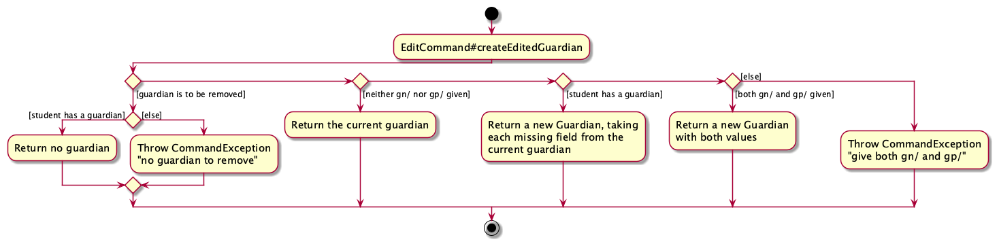

So a student who has a guardian can change just the guardian's name or phone, but a student without one needs both to get one, the same as in `add`.

In the data file, `JsonAdaptedPerson` stores the guardian as a nested `JsonAdaptedGuardian`, and leaves it out when the student has no guardian. A file without a guardian, such as one from before guardians were added, loads as a student without a guardian.

`Person#isSamePerson` compares only names, so the guardian does not affect whether two students count as duplicates.

#### Design considerations

**Aspect: How to store the guardian**

* **Alternative 1:** Two optional fields on `Person`, a guardian name and a guardian phone.
  * Pros: No new class.
  * Cons: A student could end up with only half a guardian, and every command that changes the guardian would need its own check to prevent that.

* **Alternative 2 (current choice):** A `Guardian` class with both fields required, and an optional `Guardian` on `Person`.
  * Pros: A half-filled guardian cannot be created, so the "both or neither" rule is kept in one place. `Guardian` reuses `Name` and `Phone`, so their validation is not duplicated.
  * Cons: One more class, and one more nested object in the data file.

* **Alternative 3:** Guardians as separate entries that several students can share.
  * Pros: A guardian of siblings is updated once for all of them.
  * Cons: Deleting or editing a student would have to handle the guardians they share, and the data file would need references between entries. This serves a low-priority user story, so it is not worth the extra complexity for now.

**Aspect: Whether a guardian can have only a name or only a phone**

* **Alternative 1:** Allow either field on its own.
  * Pros: The tutor can record whatever they know.
  * Cons: A guardian without a phone cannot be contacted, and a phone without a name does not say who answers. The user stories for guardians are about contacting them.

* **Alternative 2 (current choice):** Require both.
  * Pros: Every saved guardian can be contacted and identified.
  * Cons: The tutor must know both before saving a guardian.

**Aspect: How to remove a guardian**

* **Alternative 1 (current choice):** `edit INDEX gn/ gp/` with both values empty.
  * Pros: Works the same way as `edit INDEX p/`, which removes the student's phone, so there is nothing new to learn.
  * Cons: An empty prefix is easy to type by mistake. To limit this, giving only one empty prefix is an error, not a removal.

* **Alternative 2:** A separate prefix or command, such as `removeguardian INDEX`.
  * Pros: Harder to trigger by mistake.
  * Cons: One more command to learn for a rare action.

### Keeping the list after an edit

`edit` keeps the displayed list or any open student record, so the tutor can work down a set of `filter` results by index.

#### Implementation

1. Before replacing the student, `EditCommand` calls `Model#keepPersonInFilteredList` with the edited student.
1. If the list is filtered, `ModelManager` first checks whether the current filter matches the edited student. It then replaces the filter with one that also accepts the edited student: `current.test(p) || p.hasSameStudentKey(editedPerson)`, and returns `true` if the old filter did not match them. If the list is not filtered, it does nothing and returns `false`.
1. `Model#setPerson` then replaces the student in place. Since the new filter accepts the edited student, they stay at the same position in the filtered list, even if they no longer match the search.
1. If `keepPersonInFilteredList` returned `true`, `EditCommand` adds a line to the result saying that the student no longer matches the last search but stays in the list. Any phone warning comes after this line.
1. `EditCommand` returns a `CommandResult` that keeps the current display, so an open `StudentDetailPanel`, which shows the student at its index in the filtered list, shows the updated details.

The filter matches the edited student by the normalized name, school, and level key rather than by name alone or `Person#equals`. This distinguishes two allowed same-name students in different schools or levels. A later command that changes only notes, such as `addnote`, still keeps the student in the list.

Each edit wraps the current filter, so after several edits in a row, every edited student stays in the list, not just the last one. The next `filter` or `list` replaces the whole filter, so the extra rules never build up across searches.

`editnote` and `deletenote` keep the list the same way. Both call `NoteCommandUtil#setPersonKeepingIndex`, which calls `keepPersonInFilteredList` before `setPerson` and adds the same line to the result. While `filter` matches only name and school, changing a note never makes a student stop matching, so this matters once the list can be filtered by note text.

#### Design considerations

**Aspect: What to show after an edit**

* **Alternative 1:** Show the full list, as AB3 does.
  * Pros: Simplest, and the user never sees a student who doesn't match the search.
  * Cons: Index numbers change, so a follow-up such as `edit 2 ...` can silently edit a different student. The tutor has to repeat `filter` after every edit.

* **Alternative 2:** Keep the filter unchanged.
  * Pros: Simple, and other students keep their index numbers.
  * Cons: A student edited so that they no longer match the search disappears. The students after them move up, and an open student record shows a different student.

* **Alternative 3 (current choice):** Keep the filter, plus the edited student.
  * Pros: Every student keeps their index number, and an open student record stays on the same student.
  * Cons: A student who no longer matches the search stays in the list until the next `filter` or `list`. The result box and the User Guide both say so, so the tutor is not left wondering why they are there.

### Filtering students

`filter` shows the students who match every filter the tutor gives, such as `filter lvl/S3 sub/Mathematics band/G2`.

#### Implementation

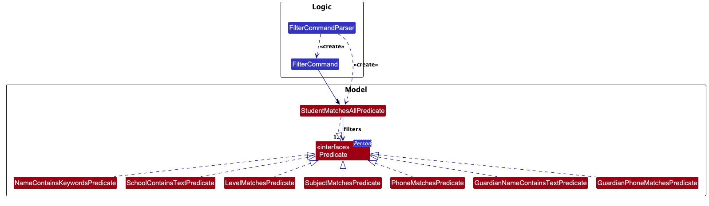

1. `FilterCommandParser` splits the arguments at the filter prefixes `n/`, `sch/`, `lvl/`, `sub/`, `band/`, `p/`, `e/`, `a/`, `gn/`, `gp/`, `t/`, and `note/`. It also recognizes `nid/`, the note index prefix of `deletenote` and `editnote`, only to reject it with a message pointing to `note/`, so that it is not read as part of another value. `note/` is read with `ArgumentTokenizer#tokenizeWithTrailingText`, so everything after it is the note text, as in `addnote`.
1. It then checks, in order, that there is no unknown prefix-shaped token, that there is no text before the first prefix, that at least one filter is given, that `t/` is not repeated, that no other prefix is repeated, and that `band/` comes with `sub/`. A repeated `t/` gets its own message, `MESSAGE_ONE_TAG`, because `add` and `edit` accept several `t/`. Any other repeated prefix gets `MESSAGE_REPEATED_FILTER`, which lists the repeated prefixes and suggests running `filter` once for each value, instead of the general duplicate-prefix message that `add` and `edit` use. If `t/` is also repeated, the `t/` message is shown first. Address values are excluded from the unknown-prefix check because `/` can be ordinary address text, while `note/` consumes all trailing text before this check.
1. It creates one `Predicate<Person>` for each filter given:

   Prefix | Predicate | Matches when the student's…
   -------|-----------|----------------------------
   `n/` | `NameContainsKeywordsPredicate` | name contains the text
   `sch/` | `SchoolContainsTextPredicate` | school contains the text
   `lvl/` | `LevelMatchesPredicate` | level is that level
   `sub/` [`band/`] | `SubjectMatchesPredicate` | subjects include that subject, at that band if given
   `p/` | `PhoneMatchesPredicate` | own phone is that number
   `e/` | `EmailContainsTextPredicate` | email contains the text
   `a/` | `AddressContainsTextPredicate` | address contains the text
   `gn/` | `GuardianNameContainsTextPredicate` | guardian's name contains the text
   `gp/` | `GuardianPhoneMatchesPredicate` | guardian's phone is that number
   `t/` | `TagMatchesPredicate` | tags include that tag
   `note/` | `NoteContainsTextPredicate` | notes include one that contains the text

1. It wraps the predicates in a `StudentMatchesAllPredicate`, which returns `true` only if every predicate does, and returns a `FilterCommand` holding it.
1. `FilterCommand#execute` passes the predicate to `Model#updateFilteredPersonList` and returns `CommandResult.showList(...)` with the number of students found, or a no-match message.

The partial-match predicates (`n/`, `sch/`, `e/`, `a/`, `gn/`, `note/`) use `StringUtil#containsIgnoreCaseAndSpaces`, which ignores case and runs of whitespace.

Names, schools, emails, and guardian names can't contain `/`, so a search for one with `/` in it can never match. `FilterCommandParser` rejects such a search with `MESSAGE_SEARCH_CANNOT_MATCH`. Addresses can contain `/`, so `a/` is checked by `AddressPrefixChecker` instead. See [Hint for a missing space before a prefix](#hint-for-a-missing-space-before-a-prefix).

Apart from `NameContainsKeywordsPredicate`, these predicates extend the abstract `ContainsTextPredicate`. It holds the text, rejects blank text, and defines `containsText`, `equals`, and `toString`, so each subclass only picks the field to search in `test`. `equals` compares classes, so `sch/bedok` and `a/bedok` are different filters.

The exact-match filters are parsed first with the same `ParserUtil` methods as `add`, into a `Level`, `Band`, `Phone`, or `Tag`, the form in which they are stored. So `lvl/s3` becomes `S3` and `p/+65 9123 4567` becomes `91234567`, and the predicates can compare values directly. Two need more:

* `TagMatchesPredicate` relies on `Tag#equals`, which ignores case. `parseTagFilter` checks for a space before calling `ParserUtil#parseTag`, so a tag with a space gets `filter`'s own message, `MESSAGE_FILTER_TAG_HAS_SPACE`, in place of `parseTag`'s advice to put `t/` before each tag.
* `SubjectMatchesPredicate` compares names with `Subject#hasName`, the same rule `add` uses to detect a repeated subject, and requires the band to belong to that same subject.

#### Design considerations

**Aspect: How to represent the filters**

* **Alternative 1:** One predicate class with an optional field for each filter.
  * Pros: Fewer classes.
  * Cons: Every new filter changes the same constructor, `test`, and `equals`, and each matching rule can only be tested through the whole class.

* **Alternative 2 (current choice):** One predicate class per filter, combined by `StudentMatchesAllPredicate`.
  * Pros: Each matching rule is small and tested on its own. Adding a filter adds one class and one parser branch, without changing the others.
  * Cons: More classes.

**Aspect: Whether filters match part of a value or the whole value**

* **Alternative 1:** Partial matching for every field.
  * Pros: One rule for the tutor to learn.
  * Cons: Short, fixed values become ambiguous: `sub/math` would match both Mathematics and Additional Mathematics, and `p/9123` would match every number containing those digits.

* **Alternative 2 (current choice):** Partial matching for free text (name, school, email, address, guardian name), exact matching for fixed values (level, subject, band, phone, tag).
  * Pros: Tutors can type part of a name or school they half remember, while fixed values match only what they mean.
  * Cons: Two rules to learn. The User Guide's filter table says which fields match partially.

**Aspect: How several filters combine**

* **Alternative 1:** A student matches if they match any filter (OR).
  * Pros: Finds more students.
  * Cons: Each extra filter widens the list, but tutors add filters to narrow it, such as all S3 students taking Mathematics.

* **Alternative 2 (current choice):** A student must match every filter (AND).
  * Pros: Each filter narrows the list, which fits planning a lesson for one group.
  * Cons: To see two schools, the tutor runs `filter` twice.

**Aspect: Whether `filter` takes one tag or several**

* **Alternative 1:** Several `t/`, and a student must have every tag (AND).
  * Pros: Matches `add` and `edit`, which accept several `t/`.
  * Cons: `t/` would be the only filter that can repeat. Tags such as `paid` and `unpaid` rarely appear together, so most combinations find no one.

* **Alternative 2:** Several `t/`, and a student needs any one of them (OR).
  * Pros: Finds students with either tag in one command.
  * Cons: `t/` would be the only filter combined with OR, which contradicts "a student must match every filter".

* **Alternative 3 (current choice):** One `t/` per `filter`.
  * Pros: Follows the same rule as every other filter, so there is no question of AND or OR. A repeated `t/` gets a message saying `filter` takes one tag.
  * Cons: To see two tags, the tutor runs `filter` twice.

**Aspect: Whether to search notes with a separate command or with `filter`**

* **Alternative 1:** A separate `findnote` command.
  * Pros: The result can list which notes matched for each student.
  * Cons: Two search commands to learn, and a note search cannot be combined with other filters.

* **Alternative 2 (current choice):** A `note/` filter in `filter`.
  * Pros: One search command. A note search combines with other filters, such as `filter lvl/S3 note/algebra`.
  * Cons: The result shows students, not which of their notes matched. `note/` must be the last filter.

### Hint for a missing space before a prefix

`ArgumentTokenizer` treats a prefix as a prefix only when a space comes before it. In `add n/John Doep/98765432 ...`, `p/98765432` becomes part of the name, so without a hint the user would see a name error that doesn't mention the missing space. Prefixes are also case-sensitive: `P/` is not the same prefix as `p/`.

#### Implementation

1. `ParserUtil#getSlashHint` returns a general hint if a slash appears in a value that cannot contain `/`. The hint does not name a prefix or quote the value.
1. When a value in `add` or `edit` fails its usual check, `ParserUtil#withSlashHint` adds the hint on a new line after the usual error. This applies to the name, phone numbers, school, email, level, subject, band, guardian name, and tags. None of these values can contain `/`, so a `/` in them is either a missing space or a character the field doesn't allow, and the hint helps in both cases.
1. Some joined prefixes cause a misleading error before the value is checked. In `gn/Mary Tangp/91234567`, the guardian phone seems missing; in `gp/91234567gn/Mary Tan`, the guardian name seems missing; and in `sub/Englishband/G1`, the band seems missing. So `AddCommandParser` checks the guardian name and phone for `/` before checking that `gn/` and `gp/` are given together, and `AddCommandParser` and `EditCommandParser` call `ParserUtil#verifySubjectNamesHaveNoSlash` before checking that each `sub/` has a `band/`.
1. `FilterCommandParser` rejects `/` in `n/`, `sch/`, `e/`, and `gn/`, with the hint. These values cannot contain `/`, so a search such as `Tangp/91234567` or `Rajesh s/o Kumar` could never match a student. The `sub/` filter adds the hint to the subject error.

1. Addresses can contain `/`, such as `Blk 1/2`, so the general slash hint would reject valid values. `AddressPrefixChecker` instead examines each slash in an address for a known prefix accepted by the current command. It matches the prefix letters without regard to case, then validates the remaining text with the parser for that field. It reports a case-sensitive-prefix error when the entered capitalization differs, or a missing-space error when the spelling is correct. It does not inspect the same `a/` prefix again.
1. `AddCommandParser` and `EditCommandParser` pass their accepted prefixes to `AddressPrefixChecker` before parsing the address. `FilterCommandParser` does the same for its address filter, including `note/`, whose trailing-text behavior is preserved. This check does not alter address text; it only rejects a likely joined parameter. A legitimate address segment that happens to be followed by a known prefix and valid field value can be interpreted as a missing space.
1. Notes can contain `/`, but `note/` takes the rest of the command, so a parameter after a note is not possible.

#### Design considerations

**Aspect: How to detect a parameter joined to an address**

* **Alternative 1:** Match the exact lowercase prefix before `/`, without checking the text after it.
  * Pros: Simple and does not mistake differently-cased text for a prefix.
  * Cons: Does not identify a common uppercase or mixed-case typo such as `P/`, and can still mistake an address segment that ends in a lowercase prefix for a parameter.

* **Alternative 2:** Match a known prefix ignoring case, without checking the text after it.
  * Pros: Catches misspelled capitalization consistently.
  * Cons: Can reject a valid address simply because text after `/` starts with letters that look like a prefix, even when the rest is not a valid value for that field.

* **Alternative 3 (current choice):** Match a known prefix ignoring case, then check whether the remaining text is valid for that field.
  * Pros: Catches lowercase joined prefixes and capitalization mistakes, while allowing ordinary slashes such as `Blk 1/2`. It can give a targeted case-sensitive message for `P/` and a missing-space message for `p/`.
  * Cons: An unusual but legitimate address can still look exactly like a prefix followed by a valid field value, so the parser may ask for a space. It does not guess how to split or silently change the address.

* **Alternative 4:** Split the address at any known prefix automatically.
  * Pros: The user may not need to retype a command when the intended split is clear.
  * Cons: The parser can guess incorrectly and save or search for different values from what the user entered.

**Aspect: Whether the error identifies a prefix**

* **Alternative 1:** Find a known prefix in the word, and name the one that starts first.
  * Pros: More specific when it is right. For `Doep/98765432`, it says to put a space before `p/`.
  * Cons: The same word can come from different mistakes. In `n/Alex Ngp/91234567`, the user meant the name `Alex Ng` and `p/`, but `gp/` starts first. In `p/91234567gp/92345678`, the user meant `gp/`. No rule gets both right, and following a wrong hint leads to a second, unrelated error. It also misses a `/` that is not a prefix, such as `s/o`, and each command needs its own list of prefixes.

* **Alternative 2 (current choice for fields that cannot contain `/`):** Show a fixed hint whenever the value contains `/`, without naming a prefix.
  * Pros: Never wrong, since it only asks the user to check their prefixes. It also covers an unknown prefix and a `/` that is not a prefix, and needs no list of prefixes.
  * Cons: Less specific. The user has to find the mistake in the command themselves.

--------------------------------------------------------------------------------------------------------------------

## **Documentation, logging, testing, dev-ops**

* [Documentation guide](Documentation.md)
* [Testing guide](Testing.md)
* [Logging guide](Logging.md)
* [DevOps guide](DevOps.md)

--------------------------------------------------------------------------------------------------------------------

## **Appendix: Requirements**

### Product scope

**Target user profile**:

* is a private tutor in Singapore who teaches secondary school students (levels S1 to S5)
* manages their tutoring alone, on their own computer
* teaches many students across different schools, levels, and subjects
* contacts both students and their guardians, and often needs to find a student quickly while a guardian is on the phone
* keeps notes on each student, such as weak topics and test results, to tailor lessons
* prefers desktop apps over other types of applications
* can type fast and prefers typing to mouse interactions
* is reasonably comfortable using CLI apps

**Value proposition**: Keep every student's contact details, guardian contact, school, level, subjects, and lesson notes in one place, and reach any of it with a short typed command, faster than with a mouse-driven app or a notebook.

### User stories

Priorities: High (must have) - `* * *`, Medium (nice to have) - `* *`, Low (unlikely to have) - `*`

| Priority | As a …​                                    | I can …​                         | So that I can …​                                                            |
| -------- | ------------------------------------------ | ------------------------------ |-----------------------------------------------------------------------------|
| `* * *` | new user | see a list of available commands | learn the app without reading a manual                                      |
| `* * *` | tutor taking a new student | add a student with their name, school, level, and subjects | keep all their details in one place from the start                          |
| `* * *` | tutor | record a student's own phone number | contact the student directly about lessons                                  |
| `* * *` | tutor | record a guardian's name and phone number on a student's record | know who to contact about that student                                      |
| `* * *` | tutor | see the guardian's name and number on the student's record | contact the guardian without searching separately                           |
| `* * *` | tutor | list all my students | check every student I teach without searching for each one                  |
| `* * *` | busy tutor | find a student by part of their name | pull up their record quickly while a guardian is on the phone               |
| `* * *` | busy tutor | view one student's full record on a single screen | avoid piecing it together from several places                               |
| `* * *` | tutor | edit a student's details | keep records correct when they change school, level, or phone number        |
| `* * *` | tutor | remove a student I added by mistake | keep my list accurate                                                       |
| `* * *` | busy tutor | add a short note to a student | tailor the next lesson to their weak topics                                 |
| `* * *` | tutor | delete a note about a student | keep the student's record focused on what matters now                       |
| `* * *` | tutor | have my data saved automatically | avoid losing records when I close the app                                   |
| `* * *` | tutor | exit the app | end my session when I'm done                                                |
| `* * *` | new user | clear all sample students | start with only my own students                                             |
| `* * *` | tutor | record the band each subject is taken at (G1, G2, or G3) | pitch the material at the right difficulty                                  |
| `* *` | tutor receiving unknown calls | find students by their guardian's phone number | identify the caller and see their children's records                        |
| `* *` | tutor planning lessons | filter students by school, level, or subject | prepare lessons for students at the same school, level, or subject together |
| `* *` | careless typist | confirm before a student is deleted | avoid erasing the wrong student's history after mistyping an ID             |
| `* *` | forgetful tutor | be stopped from adding a student with the same name, school, and level as an existing student | avoid duplicate records                                                     |
| `* *` | tutor | edit a note | update a student's progress without deleting and retyping it                |
| `* *` | careless typist | undo my last command | recover from a mistyped delete                                              |
| `* *` | tutor | find students whose notes contain a keyword, such as a topic | group students with the same weakness for revision                          |
| `*` | expert user | use short aliases for commands | type commands faster once I know the app                                    |
| `*` | tutor with students on break | mark a student as inactive instead of deleting them | keep their history in case they come back                                   |
| `*` | tutor teaching siblings | link siblings to the same guardian | update a shared guardian's details once for all their children              |
| `*` | tutor running small groups | create a group and add students to it | handle a group class as one unit                                            |
| `*` | expert user | recall my previous command | fix a mistake in it quickly without retyping                                |
| `*` | careless typist | confirm before a note is deleted | avoid deleting the wrong note after mistyping a note number                 |
| `*` | fast typist | launch the app from the terminal | start the app without switching to the mouse                                |

### Use cases

(For all use cases below, the **System** is the `AddressBook` and the **Actor** is the `user`, unless specified otherwise)

**Use case: UC1 - Add a student**

**MSS**

1.  Tutor requests to add a student, giving the name, school, level, at least one subject, each with its subject band (for example Chemistry at G3), and optionally a phone number and guardian details
2.  TuteeBook3 validates the details
3.  TuteeBook3 saves the student
4.  TuteeBook3 shows the student list with the new student selected

    Use case ends.

**Extensions**

* 2a. A required detail is missing or invalid.

    * 2a1. TuteeBook3 shows an error message stating which detail is wrong.

    * 2a2. Tutor enters the corrected details.

      Steps 2a1-2a2 are repeated until the details are valid.

      Use case resumes at step 3.

* 2b. Only one of guardian name and guardian phone is given.

    * 2b1. TuteeBook3 shows an error message that both must be provided together.

    * 2b2. Tutor enters the corrected details.

      Steps 2b1-2b2 are repeated until the details are valid.

      Use case resumes at step 3.

* 2c. More than 8 subjects are given, or the same subject is given more than once (even with a different subject band).

    * 2c1. TuteeBook3 shows an error message stating the problem.

    * 2c2. Tutor enters the corrected details.

      Steps 2c1-2c2 are repeated until the details are valid.

      Use case resumes at step 3.

* 2d. A subject name is invalid, or a subject has no subject band or one that is not G1, G2 or G3.

    * 2d1. TuteeBook3 shows an error message stating the expected format.

    * 2d2. Tutor enters the corrected details.

      Steps 2d1-2d2 are repeated until the details are valid.

      Use case resumes at step 3.

* 2e. The student has the same normalized name, school, and level as an existing student.

    * 2e1. TuteeBook3 shows an error message identifying the existing student and does not add the student.

      Use case ends.

* 2f. Another student has the same normalized name, but a different school or level.

    * 2f1. TuteeBook3 shows an amber prompt with the existing student's school and level.

    * 2f2. Tutor confirms the addition by entering `CONFIRM`.

      Use case resumes at step 3.

    * 2f3. Tutor enters any other input.

      The pending add is cancelled, and TuteeBook3 processes the input as a command.

* 2g. The phone number or guardian phone number is not a Singapore number.

    * 2g1. TuteeBook3 accepts the number, and shows a warning asking Tutor to check it after saving the student.

      Use case resumes at step 3.

---

**Use case: UC2 - Edit a student's details**

**MSS**

1.  Tutor requests to list students, or filters them by name (UC4)
2.  TuteeBook3 shows a list of students
3.  Tutor requests to edit a specific student by index, giving the new values for the details to change
4.  TuteeBook3 validates and updates the student
5.  TuteeBook3 shows the updated details

    Use case ends.

**Extensions**

* 2a. The list is empty.

  Use case ends.

* 3a. The given index is invalid.

    * 3a1. TuteeBook3 shows an error message.

      Use case resumes at step 2.

* 3b. No detail is given to change, or a new value is invalid.

    * 3b1. TuteeBook3 shows an error message.

    * 3b2. Tutor enters the corrected command.

      Steps 3b1-3b2 are repeated until the command is valid.

      Use case resumes at step 4.

* 3c. The edit would give the student the same normalized name, school, and level as another student.

    * 3c1. TuteeBook3 shows an error message and leaves the student unchanged.

      Use case ends.

* 3d. The edited name matches another student, but the school or level is different.

    * 3d1. TuteeBook3 shows an amber prompt with the matching student's school and level.

    * 3d2. Tutor confirms the edit by entering `CONFIRM`.

      Use case resumes at step 4.

    * 3d3. Tutor enters any other input.

      The pending edit is cancelled, and TuteeBook3 processes the input as a command.

* 3e. The student has no guardian, and Tutor gives only one of guardian name and guardian phone.

    * 3e1. TuteeBook3 shows an error message that both are needed to add a guardian, and leaves the student unchanged.

      Use case resumes at step 3.

* 3f. Tutor requests to remove the guardian of a student who has no guardian.

    * 3f1. TuteeBook3 shows an error message that the student has no guardian to remove, and leaves the student unchanged.

      Use case ends.

* 3g. A new phone number or guardian phone number is not a Singapore number.

    * 3g1. TuteeBook3 accepts the number, and shows a warning asking Tutor to check it after updating the student.

      Use case resumes at step 4.

* 4a. The list shows search results, and the updated student no longer matches the search.

    * 4a1. TuteeBook3 keeps the student at the same position in the list, and says that they no longer match the search.

      Use case resumes at step 5.

---

**Use case: UC3 - Delete a student**

**MSS**

1.  Tutor requests to list or filter students
2.  TuteeBook3 shows the corresponding list of students
3.  Tutor requests to delete a specific student by index
4.  TuteeBook3 asks Tutor to confirm the deletion
5.  Tutor confirms the deletion
6.  TuteeBook3 deletes the student and all of the student's notes, preserves any active filter that still has matches, and shows the remaining students

    Use case ends.

**Extensions**

* 2a. The list is empty.

  Use case ends.

* 3a. The given index is invalid.

    * 3a1. TuteeBook3 shows an error message.

      Use case resumes at step 2.

* 5a. Tutor enters anything other than the exact uppercase word `CONFIRM` after trimming leading and trailing spaces.

    * 5a1. TuteeBook3 cancels the pending deletion, displays a red cancellation notice, and processes the input as a command.

      Use case resumes at the relevant step for that command.

* 6a. The active filter has no matches after the deletion, but other students remain.

    * 6a1. TuteeBook3 shows the full list and explains that the filtered list became empty.

      Use case ends.

* 6b. TuteeBook3 fails to save the change.

    * 6b1. TuteeBook3 shows an error message and no data is changed.

      Use case ends.

---

**Use case: UC4 - Find students by name**

**MSS**

1.  Tutor requests to find students, giving part of a student's name
2.  TuteeBook3 shows the list of students whose names contain that part of a name, ignoring case.

    Use case ends.

**Extensions**

* 1a. The name is missing or invalid.

    * 1a1. TuteeBook3 shows an error message.
    * 1a2. Tutor enters the corrected command.

      Steps 1a1-1a2 are repeated until the command is valid.

      Use case resumes at step 2.

* 2a. No students match the name.

  Use case ends.

---

**Use case: UC5 - View a student's record**

**MSS**

1. Tutor requests to view a specific student by index.
2. TuteeBook3 keeps the fixed, equal-width student list on the left, highlights the student's non-clickable list card, and opens the student's details and notes in one scrollable record on the right.

Use case ends.

**Extensions**

* 1a. The given index is invalid.
  * 1a1. TuteeBook3 shows an error message.

  Use case resumes at step 1.

* 2a. The student has no notes.
  * 2a1. TuteeBook3 shows the card with an empty notes section.

  Use case ends.

---

**Use case: UC6 - Find students by text in their notes**

**MSS**

1. Tutor requests to find students who have a note containing some text.
2. TuteeBook3 shows the list of students who have at least one note containing that text, ignoring case and extra spaces.
3. Tutor requests to view one of them by index.
4. TuteeBook3 shows the student's full record, including all of their notes.

Use case ends.

**Extensions**

* 1a. The text is blank or longer than 500 characters.
  * 1a1. TuteeBook3 shows an error message.
  * 1a2. Tutor enters corrected text.

  Steps 1a1-1a2 are repeated until the text is valid. Use case resumes at step 2.

* 1b. Tutor also narrows the search by other details, such as level or school.
  * 1b1. TuteeBook3 shows only the students who match all of them.

  Use case resumes at step 3.

* 2a. No student has a note containing the text.
  * 2a1. TuteeBook3 informs Tutor that no students match.

  Use case ends.

* 3a. The given index is invalid.
  * 3a1. TuteeBook3 shows an error message.

  Use case resumes at step 2.

---

**Use case: UC7 - Add a note to a student**

**MSS**

1.  Tutor requests to list students
2.  TuteeBook3 shows a list of students
3.  Tutor requests to add a note to a specific student in the list
4.  TuteeBook3 adds the note to the student's notes
5.  TuteeBook3 shows the student's updated record and confirms that the note is added

    Use case ends.

**Extensions**

* 2a. The list is empty.

    Use case ends.

* 3a. The given index is invalid.

    * 3a1. TuteeBook3 shows an error message.

      Use case resumes at step 2.

* 3b. The note text is blank or too long.

    * 3b1. TuteeBook3 shows an error message.

    * 3b2. Tutor enters the corrected command.

      Steps 3b1-3b2 are repeated until the command is valid.

      Use case resumes at step 4.

---

**Use case: UC8 - Edit a note**

**MSS**

1.  Tutor views a specific student's record (UC5)
2.  TuteeBook3 shows the student's record with numbered notes
3.  Tutor requests to edit a specific note, giving the student's index, note number and new text
4.  TuteeBook3 validates the text and replaces the note's text
5.  TuteeBook3 shows the updated record and a success message with the note's old and new text

    Use case ends.

**Extensions**

* 1a. Tutor already knows the student's index and the note's number.

    Use case resumes at step 3.

* 2a. The student has no notes.

    Use case ends.

* 3a. The given index is invalid, or the given note number does not exist for that student.

    * 3a1. TuteeBook3 shows an error message.

      Use case resumes at step 3.

* 3b. The new text is blank or too long.

    * 3b1. TuteeBook3 shows an error message.

    * 3b2. Tutor enters the corrected text.

      Steps 3b1-3b2 are repeated until the text is valid.

      Use case resumes at step 4.

* 3c. The new text is the same as the note's current text.

    * 3c1. TuteeBook3 keeps the note as it is, shows the student's record, and warns that the note was not changed.

      Use case ends.

---

**Use case: UC9 - Delete a note from a student**

**MSS**

1.  Tutor requests to view a specific student by index
2.  TuteeBook3 shows the student's record with numbered notes
3.  Tutor requests to delete a specific note, giving the student's index and NID
4.  TuteeBook3 asks Tutor to confirm deleting the note.
5.  Tutor confirms, and TuteeBook3 deletes the note, renumbers the remaining notes, and shows the updated student record and a success message.

    Use case ends.

**Extensions**

* 1a. The given index is invalid.

    * 1a1. TuteeBook3 shows an error message.

      Use case ends.

* 2a. The student has no notes.

    Use case ends.

* 3a. The given index or NID is invalid, or the student has no such note.

    * 3a1. TuteeBook3 shows an error message.

      Use case resumes at step 2.

* 4a. Tutor cancels the deletion.

    * 4a1. TuteeBook3 keeps the note and reports that no changes were made.

      Use case ends.

---

**Use case: UC10 - View help**

**MSS**

1. Tutor requests help.
1. TuteeBook3 shows the User Guide URL as selectable plain text, followed by each available command as a summary and a minimal example on the next line, with blank lines between commands. TuteeBook3 does not copy the URL automatically.

    Use case ends.

**Extensions**

* 1a. Help is already shown in the result display.

    * 1a1. TuteeBook3 reuses the result display and returns the help content to the top.

      Use case resumes at step 2.

* 2a. Tutor wants more detailed instructions.

    * 2a1. Tutor selects and copies the User Guide URL using the operating system's copy shortcut.

    * 2a2. Tutor pastes the URL into a browser and opens the User Guide.

      Use case ends.

---

**Use case: UC11 - Clear all students**

**MSS**

1.  Tutor requests to list students
2.  TuteeBook3 shows the students, including the sample students
3.  Tutor requests to clear all students
4.  TuteeBook3 shows an amber warning that all students and notes will be deleted, and asks Tutor to enter `CONFIRM`; any other input cancels the request and runs as a command
5.  Tutor enters `CONFIRM`
6.  TuteeBook3 removes all students and their notes
7.  TuteeBook3 shows an empty roster

    Use case ends.

**Extensions**

* 3a. TuteeBook3 is already empty.

    * 3a1. TuteeBook3 informs Tutor that it is already empty and does not ask for confirmation.

      Use case ends.

* 3b. Tutor requests to clear all students using `clear -f`.

    * 3b1. TuteeBook3 removes all students and their notes without asking for confirmation.
    * 3b2. TuteeBook3 shows an empty roster.

      Use case ends.

* 5a. Tutor enters anything other than the exact uppercase word `CONFIRM` after trimming leading and trailing spaces.

    * 5a1. TuteeBook3 cancels the pending `clear` request, displays a red cancellation notice, and processes the input as a command.

      Use case resumes at the relevant step for that command.

### Non-Functional Requirements

1. Should run on any _mainstream OS_ with only Java `25` installed, without OS-specific libraries or features.
2. Should respond to commands within two seconds with up to 1000 student records.
3. Should prioritize typed commands for tutors who prefer typing, with GUI feedback and keyboard access to all student and note commands.
4. Should support all student and note commands offline, without a team-operated remote server.
5. Should save successful changes in local, human-editable JSON files, without a DBMS, and retain them after restarting.
6. Should reject invalid commands without crashing or changing records, and explain errors and corrections.
7. Should work well at resolutions of 1920 × 1080 or higher at 100% and 125% scaling, and remain usable at 1280 × 720 or higher at 150% scaling.
8. Should keep student and guardian data local and omit personal details from diagnostic logs.
9. Should report save failures and preserve previously saved records.
10. A first-time tutor should be able to add, find, and view a student and add a note within ten minutes using the supplied help.
11. Should serve one tutor, without shared-computer accounts or shared data files between users.
12. Should support manual data-file editing at least as well as AB3: load valid edits and report invalid files without crashing.
13. Should use a primarily object-oriented design.
14. Should use free, permissively licensed dependencies approved by the teaching team, with no user installation; libraries and frameworks must be open source.
15. Should ship without an installer as one JAR (or one ZIP if necessary), no larger than 100 MB.

### Glossary

#### General

Term | Meaning
-----|--------
**AB3** | AddressBook-Level3, the sample project that TuteeBook3 is built on.
**CLI** | Command-line interface. A way of using an app by typing commands instead of clicking.
**DBMS** | Database management system. Software, such as MySQL, that stores data in a database. TuteeBook3 does not use one.
**Digit** | One of the ASCII digits `0` to `9`. Digits from other writing systems, such as the full-width `１`, are not digits.
**English letter** | One of the ASCII letters `A` to `Z` or `a` to `z`. Accented letters, such as `é`, and letters from other alphabets are not English letters.
**GUI** | Graphical user interface. The windows, lists, and boxes that you see and click.
**JAR** | Java Archive. The single file that contains the whole app, which you run with Java.
**JSON** | JavaScript Object Notation. The text format that TuteeBook3 uses to save data in a file that can be read and edited by hand.
**Keyboard symbol** | One of the 32 printable ASCII symbols, which are the characters in `\x21` to `\x7E` other than English letters and digits: `` ! " # $ % & ' ( ) * + , - . / : ; < = > ? @ [ \ ] ^ _ ` { | } ~ ``. Other symbols, such as `£` and `°`, curly quotes, such as `“` and `’`, long dashes, such as `–`, and emoji are not keyboard symbols.
**Mainstream OS** | Windows, Linux, Unix, macOS.

#### Tutoring terms

Term | Meaning
-----|--------
**Band** | The standard at which a student takes a subject: G1, G2, or G3. These come from Singapore's Full Subject-Based Banding, where G3 is the most demanding. Each subject has its own band, so a student may take Mathematics at G3 and Science at G2.
**Guardian** | A parent or other adult responsible for a student, whom the tutor contacts about the student's progress. A student has at most one guardian, recorded with both a name and a phone number.
**Level** | A student's year of secondary school, from S1 (Secondary 1) to S5 (Secondary 5).
**Note** | A short piece of text that the tutor attaches to a student, such as "Weak in Geometry" or "WA2 Math: 36/50".
**Student** | A secondary school student whom the tutor teaches.
**Subject** | A school subject that the tutor teaches the student, such as "Mathematics" or "Chemistry".
**Tag** | A short label that the tutor attaches to a student to group or flag them at a glance, such as "paid" or "O-level". A tag is one word, which may contain hyphens. A student can have any number of tags.

#### Commands

Term | Meaning
-----|--------
**Confirmation prompt** | An amber message that asks you to confirm a command before it runs. `delete`, `deletenote`, and `clear` show one before they delete anything, and `add` and `edit` show one when another student already has the same name. Type `CONFIRM` in uppercase to go ahead. Any other input, including `confirm`, cancels the command and runs as a normal command.
**Exact matching** | The way the `lvl/`, `sub/`, `band/`, `p/`, `gp/`, and `t/` filters of `filter` compare values. The whole value must match, ignoring case and extra spaces. For example, `lvl/S3` matches only students in S3, and `sub/math` does not match `Mathematics`.
**Filter** | A prefix and value given to the `filter` command, such as `n/Tan`, that narrows down the student list.
**Force flag** | The `-f` option of `delete`, `deletenote`, and `clear`, such as `delete -f 1`. It skips the confirmation prompt, so the command runs immediately. `add` and `edit` have no force flag.
**Index** | The number shown next to a student in the list currently on screen. Commands such as `view`, `edit`, and `delete` use it to pick a student. It is not permanent: it can change when the list changes, such as after `add`, `delete`, `filter`, or `list`.
**NID** | The number shown before a note in the student detail view. Notes are numbered 1, 2, 3 in the order they were added. After a note is deleted, the notes after it move up one number, so an NID is not permanent.
**Partial matching** | The way the `n/`, `sch/`, `e/`, `a/`, `gn/`, and `note/` filters of `filter` compare values. The value only needs to contain what you typed, even part of a word, ignoring case. For example, `sch/vic` matches `Victoria School`.
**Prefix** | A short marker ending in `/`, such as `n/` or `sch/`, that labels the value after it in a command.
**Warning** | An amber message that flags something that might be a mistake, without stopping the command. For example, TuteeBook3 saves a phone number that doesn't look like a Singapore number, but shows a warning so that you can check it.

#### Screen layout

Term | Meaning
-----|--------
**Command box** | The text field at the top of the window where you type commands.
**Detail view** | The panel on the right of the window that shows everything about one student, including all their notes. It is also called the "detail panel" or "student detail view". `view` shows a student there, and `list` and `filter` clear it.
**Result display** | The area below the command box that tells you whether your last command worked, and why not if it failed. It is also called the "feedback box" or "result box".
**Student card** | One student's entry in the student list.
**Student list** | The panel on the left of the window that lists students with their main details. It shows all students, or the results of your last `filter`.

#### Code

Term | Meaning
-----|--------
**AddressBook** | The class that holds every `Person` in the app.
**Logic** | The component that turns what the user typed into a command and runs it.
**Model** | The component that holds the app's data while it runs and applies every change to it.
**Parser** | A class that checks what the user typed and turns it into a `Command` object, for example `AddCommandParser` for the `add` command.
**Person** | The class that stores one student's details. The name is kept from AB3.
**Storage** | The component that loads the data file when the app starts and saves every change back to it.

--------------------------------------------------------------------------------------------------------------------

## **Appendix: Instructions for manual testing**

Given below are instructions to test the app manually.

:information_source: **Note:** These instructions only provide a starting point for testers to work on;
testers are expected to do more *exploratory* testing.

### Launch and shutdown

1. First launch and relaunch

   1. Prerequisites: Download `TuteeBook3.jar` and copy it into an empty folder. Open a terminal in that folder.

   1. Run `java -jar TuteeBook3.jar`. 
      Expected: The GUI opens with a set of sample students. The folder now contains `preferences.json`.

   1. Enter `add n/Manual Test Student sch/Victoria School lvl/S2 sub/Mathematics band/G1`. 
      Expected: Manual Test Student is added, and `data/addressbook.json` is created.

   1. Close the window, and run `java -jar TuteeBook3.jar` again. Enter `filter n/Manual Test Student`. 
      Expected: Manual Test Student appears in the student list, showing that the saved data was loaded after relaunch.

1. Saving window preferences

   1. Prerequisites: Launch TuteeBook3 as described in the previous test.

   1. Resize the window, move it to a different location, and close it.

   1. Run `java -jar TuteeBook3.jar` again. 
      Expected: The window opens at the most recently saved size and location.

### Deleting a student

1. Deleting a student while all students are shown

   1. Prerequisites: Use the `list` command to show multiple students.

   1. Test case: Enter `delete 1`, then enter `CONFIRM`. 
      Expected: The first student is deleted. The status message shows the deleted student's details.

   1. Test case: `delete -f 1` 
      Expected: The first student is deleted without a confirmation prompt. The status message shows the deleted student's details.

   1. Test case: `delete 0` 
      Expected: No student is deleted. The status message shows an invalid index error.

### Adding and editing a guardian

1. Adding a student with a guardian

   1. Test case: `add n/Tim Tan sch/Victoria School lvl/S2 sub/Mathematics band/G1 gn/Mary Tan gp/91234567` 
      Expected: Tim Tan is added. Viewing his student details shows guardian Mary Tan with phone number `91234567`.

   1. Test case: `add n/Ken Lim sch/Victoria School lvl/S2 sub/Mathematics band/G1 gn/Mary Lim` 
      Expected: No student is added. The status message says that guardian name and guardian phone must be given together.

   1. Test case: `add n/Ken Lim sch/Victoria School lvl/S2 sub/Mathematics band/G1` 
      Expected: Ken Lim is added. Viewing his student details shows `Not provided` for both guardian fields.

1. Editing a guardian

   1. Prerequisites: Tim Tan and Ken Lim were added as above. Use `filter n/Tim` or `filter n/Ken` so that the student is first in the list.

   1. Test case: `edit 1 gp/98765432` on Tim Tan 
      Expected: Only the guardian's phone changes. Viewing Tim Tan's student details shows guardian Mary Tan with phone number `98765432`.

   1. Test case: `edit 1 gn/Peter Lim` on Ken Lim 
      Expected: Ken Lim is unchanged. The status message says to give both guardian fields when adding a guardian.

   1. Test case: `edit 1 gn/ gp/91234567` on Tim Tan 
      Expected: Tim Tan is unchanged. The status message says that guardian name and guardian phone cannot be empty.

   1. Test case: `edit 1 gn/ gp/` on Tim Tan 
      Expected: The guardian is removed, and viewing the student's details shows `Not provided` for both guardian name and guardian phone.

   1. Test case: `edit 1 gn/ gp/` on Ken Lim 
      Expected: Ken Lim is unchanged. The status message says that the student has no guardian to remove.

### Adding and editing tags

1. Adding a student with tags

   1. Test case: `add n/Mei Lin sch/Victoria School lvl/S2 sub/Mathematics band/G1 t/exams t/Paid` 
      Expected: Mei Lin is added. Her list card shows the tags `exams` and `Paid`, in that order.

   1. Test case: `add n/Ken Ong sch/Victoria School lvl/S2 sub/Mathematics band/G1 t/Paid t/paid` 
      Expected: No student is added. The status message reports the duplicate tag.

   1. Test case: `add n/Ken Ong sch/Victoria School lvl/S2 sub/Mathematics band/G1 t/exam_prep` 
      Expected: No student is added. The status message explains that a tag can contain only letters, digits, and single hyphens.

   1. Test case: `add n/Ken Ong sch/Victoria School lvl/S2 sub/Mathematics band/G1 t/O-level` 
      Expected: Ken Ong is added with the tag `O-level`.

   1. Test case: `add n/Ken Ong sch/Victoria School lvl/S2 sub/Mathematics band/G1 t/exam prep` 
      Expected: No student is added. The status message explains that each tag is one word and needs its own `t/` prefix.

1. Editing tags

   1. Prerequisites: Mei Lin was added as above. Use `filter n/Mei` so that she is first in the list.

   1. Test case: `edit 1 t/online` 
      Expected: Mei Lin's only tag is now `online`.

   1. Test case: `edit 1 t/` 
      Expected: Mei Lin has no tags. Her list card shows no tags, and viewing her details shows `Not provided` for tags.

### Entering phone numbers

1. Adding a student with a formatted Singapore number

   1. Test case: `add n/Ravi Kumar sch/Victoria School lvl/S2 sub/Mathematics band/G1 p/+65 9123-4567` 
      Expected: Ravi Kumar is added with phone number `91234567`. The status message shows no warning about the phone number.

1. Editing the phone number

   1. Prerequisites: Ravi Kumar was added as above. Before each test case, use `filter n/Ravi` so that Ravi Kumar is first in the list.

   1. Test case: `edit 1 p/+44 7911 123456` 
      Expected: The phone number is saved as `+447911123456`. The status message is shown in amber, with a warning that phone `+447911123456` doesn't look like a Singapore number.

   1. Test case: `edit 1 sch/Bedok Green Secondary School` 
      Expected: The school changes. The status message shows no warning about the phone number.

   1. Test case: `edit 1 p/12` 
      Expected: Ravi Kumar is unchanged. The status message says that a phone number must have 3 to 15 digits.

### Editing a student in search results

1. Editing a student so they no longer match the search

   1. Prerequisites: Start with the sample data. Enter `filter n/an`, which lists `Chloe Tan`, `Aisha Rahman`, `Daniel Lee`, and `Ethan Kumar`, then `view 1`. Run the test cases in order.

   1. Test case: `edit 1 n/Chloe Lim` 
      Expected: The student record stays open and shows Chloe Lim. The status message says that she no longer matches the last search but remains in the list until the next `list` or `filter` command.

   1. Test case: `edit 2 lvl/S4` 
      Expected: The student record still shows Chloe Lim, so she is still first in the list even though another student was edited. The status message reports that Aisha Rahman was edited without a search warning. Enter `list`, then `filter n/an`: the list shows Aisha Rahman (now `S4`), Daniel Lee, and Ethan Kumar, and Chloe Lim is no longer in the results.

### Adding, editing, and deleting notes

The rules for `INDEX`, `NID`, and `TEXT` are in the User Guide's [Managing notes](UserGuide.md#managing-notes) section.

Prerequisites: Start with the sample data. Enter `filter n/Marcus` so that `Marcus Lim` is first in the list, then `view 1`. Marcus Lim has one note. Run the test cases in order.

1. Adding a note

   1. Test case: `addnote 1 note/WA2 Math: 36/50` 
      Expected: Marcus Lim's record shows `WA2 Math: 36/50` as note 2, after his existing note.

   1. Test case: `addnote 0 note/Weak in algebra` 
      Expected: No note is added. The status message says that the index must be a positive integer shown in the student list.

1. Editing a note

   1. Test case: `editnote 1 nid/2 note/WA2 Math: 42/50` 
      Expected: Note 2 now reads `WA2 Math: 42/50`, and note 1 is unchanged. The status message shows the old and new text.

   1. Test case: `editnote 1 nid/5 note/Weak in algebra` 
      Expected: No note is changed. The status message says that NID 5 does not exist and that Marcus Lim has only 2 notes.

1. Deleting a note

   1. Test case: `deletenote 1 nid/1` 
      Expected: No note is deleted yet. An amber prompt names note 1 of Marcus Lim and asks you to type `CONFIRM`.

   1. Test case: `CONFIRM`, right after the previous test case 
      Expected: Note 1 is deleted. `WA2 Math: 42/50` moves up to become note 1.

   1. Test case: `deletenote -f 1 nid/1` 
      Expected: Note 1 is deleted without a prompt. Marcus Lim's record shows `No notes recorded.`

### Saving data

1. Starting with an invalid field in otherwise valid JSON

   1. Prerequisites: Close TuteeBook3, copy `data/addressbook.json` to a backup outside the `data` folder, and change the first student's `"level"` to `"S6"`.

   1. Run `java -jar TuteeBook3.jar` without entering any command. 
      Expected: TuteeBook3 opens with an empty student list because `S6` is not a valid secondary school level.

   1. Close TuteeBook3, replace `data/addressbook.json` with the backup, and relaunch it. 
      Expected: The students from the backup appear.

--------------------------------------------------------------------------------------------------------------------

## **Appendix: Effort**

TuteeBook3 keeps AB3's architecture, but replaces or extends most of its features to build a richer student record, two-step confirmations, and a multi-field search.

### Difficulty compared with AB3

AB3 manages one entity, `Person`, with four single-value fields and a set of tags, and every command works on the whole record in one step. A TuteeBook3 student record holds a school, a level, 1 to 8 subject and band pairs, an optional guardian, tags, and an indexed list of notes. Notes act as a second entity inside a student, with their own `addnote`, `editnote`, and `deletenote` commands. Each part needed its own parser rules, model class, and UI display, and subjects, the guardian, and notes each needed their own JSON adapter.

### Challenges

Each part below needed changes across the parser, model, storage, and UI, and the Implementation section explains the design behind it.

* **Fixing flaws inherited from AB3.** Before adding features, the team audited AB3 and logged 37 problems. Several needed code fixes, such as an index overflow in `delete 2147483648` and a stack overflow on a very long email.
* **Duplicate detection.** A normalized name, school, and level key had to hold in `add`, `edit`, confirmed commands, `UniquePersonList`, and JSON loading, while a name-only match asks for confirmation instead of failing. This blocks records the tutor cannot tell apart without blocking real students who share a name ([#194](https://github.com/AY2627S1-CS2103T-T09-1/tp/issues/194), [#209](https://github.com/AY2627S1-CS2103T-T09-1/tp/pull/209)).
* **Two-step commands.** AB3's `Logic` runs each command and forgets it. TuteeBook3 adds a pending-command state, shared through `ConfirmationManager` and `ConfirmationCommand` by `clear`, `delete`, `deletenote`, and name-match warnings in `add` and `edit`. Any input other than `CONFIRM` must cancel the request and still run as a normal command ([#174](https://github.com/AY2627S1-CS2103T-T09-1/tp/pull/174), [#196](https://github.com/AY2627S1-CS2103T-T09-1/tp/pull/196)).
* **Multi-field search.** `filter` replaces AB3's `find` with 11 filters, each its own predicate class combined by `StudentMatchesAllPredicate`. The parser mixes partial matching for free text with exact matching for fixed values, rejects text that only looks like a prefix, and gives a specific error for each malformed filter ([#198](https://github.com/AY2627S1-CS2103T-T09-1/tp/pull/198), [#253](https://github.com/AY2627S1-CS2103T-T09-1/tp/pull/253), [#217](https://github.com/AY2627S1-CS2103T-T09-1/tp/pull/217)).
* **Warning instead of blocking.** To accept an overseas phone number while still catching typos, the team accepts 3 to 15 digits and warns when a number is not a Singapore number. This needed a warning path in `CommandResult`, an amber result style, and the same normalization when the data file loads ([#175](https://github.com/AY2627S1-CS2103T-T09-1/tp/pull/175)). A missing space before a prefix gets a hint, which `AddressPrefixChecker` extends to addresses, where `/` can be ordinary text ([#279](https://github.com/AY2627S1-CS2103T-T09-1/tp/pull/279)).
* **Stable indexes after an edit.** AB3 shows the full list after an edit, so a follow-up `edit 2` can change a different student. `Model#keepPersonInFilteredList` keeps the current filter plus the edited student ([#193](https://github.com/AY2627S1-CS2103T-T09-1/tp/pull/193)).

### Effort required

Line counts follow the [RepoSense tP Dashboard](https://nus-cs2103-ay2627-s1.github.io/tp-dashboard/?search=AY2627S1-CS2103T-T09-1%2Ftp&sort=groupTitle&sortWithin=title&timeframe=commit&mergegroup=&groupSelect=groupByRepos&breakdown=true&checkedFileTypes=functional-code&since=2026-09-18), which counts the Java, FXML, and CSS files in `src/main` as functional code, including comments and blank lines.

Measure | AB3 | TuteeBook3
--------|-----|-----------
Functional code in the product | 5,261 lines | 9,886 lines
Functional code written by the team, as credited by RepoSense | Not applicable | 5,113 lines (4,545 non-blank)
User commands | 8 | 12, plus `CONFIRM`

:information_source: **Note:** The line counts were taken on 30 October 2026, and may not exactly match the current code. RepoSense regenerates its report as the team adds code, so the figures on the dashboard may differ slightly from those in this table.

RepoSense does not count lines kept from AB3, so the team wrote about as much functional code as AB3 contains in total. Much of it is validation and error handling, such as about 300 lines each in `ParserUtil` and `EditCommand`. The team also added:

* 5 commands with their parsers: `view`, `filter`, `addnote`, `editnote`, and `deletenote`.
* 6 field classes (`School`, `Level`, `Subject`, `Band`, `Guardian`, and `Note`) and 3 JSON adapters.
* 12 search predicate classes for `filter`.
* A student detail panel beside the list.

### Achievements

* Each student's school, level, subjects with bands, guardian, tags, and notes are kept in one record, shown together with `view`, and grouped for lessons with `filter`.
* The parsers, the model, and JSON loading share each field's rules, so a hand-edited data file is checked like typed input.
* Destructive commands ask for `CONFIRM`, and `-f` runs them in one step for a tutor who is sure.
* Unusual but valid input, such as an overseas phone number or an email with no dot in its domain, is saved with a warning instead of being rejected.
* After an edit, every student in the filtered list keeps their index, even one who may no longer match the search, so a follow-up command by index still targets the student the tutor expects.

### Reuse

This project is based on the AddressBook-Level3 project created by the [SE-EDU initiative](https://se-education.org). TuteeBook3 keeps AB3's architecture and GUI framework, still stores data as JSON, and adds no runtime libraries. TestFX was added only for GUI tests.

### Beyond implementation

This section describes work outside implementation.

* **Project management:** The team created over 190 issues and merged at least 150 pull requests. After v1.3, nearly every pull request was approved by a teammate before merging.
* **Testing:** The team wrote over 9,000 lines of test code, which cover over 90% of the code.
* **UML diagrams:** The team checked AB3's UML diagrams against the code and fixed the ones that did not match, such as a delete sequence diagram that passed an index to `Model#deletePerson`, which takes a `Person`. It also found that a newer PlantUML version mostly fixes the lifeline limitation AB3 noted, adopted it, and notes the smaller limitation that remains.
