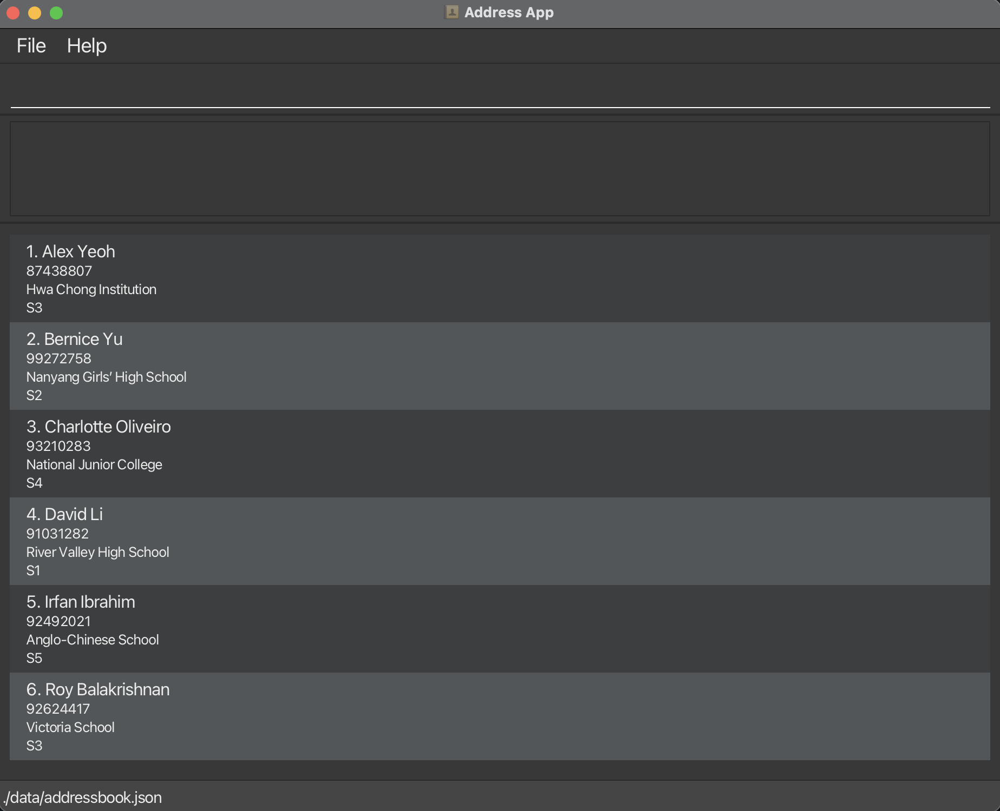
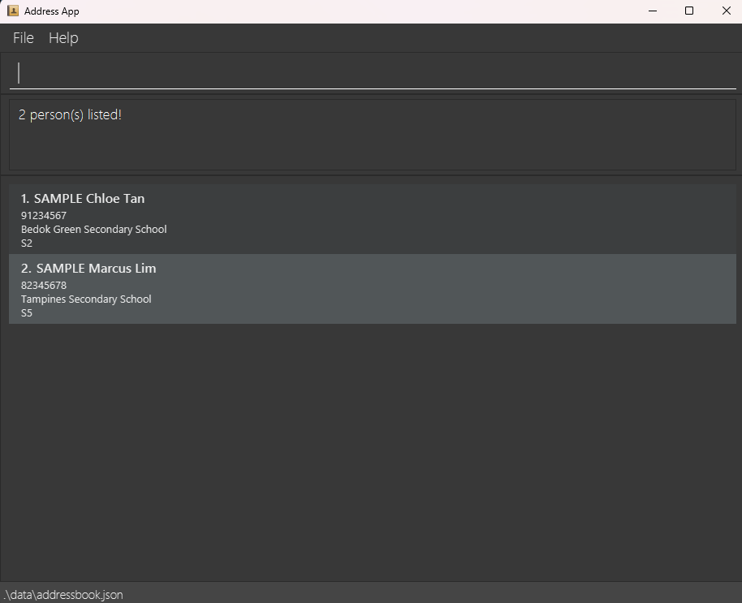

TuteeBook3 is a **desktop app for private tutors who teach secondary school students (S1 to S5) in Singapore, optimized for use through a Command Line Interface (CLI)** while keeping the benefits of a Graphical User Interface (GUI). It keeps each student's information in one place, so you can look up a student's full record with a short typed command. If you type quickly, TuteeBook3 helps you manage your students faster than a spreadsheet or a traditional GUI app.

* Table of Contents
{:toc}

--------------------------------------------------------------------------------------------------------------------

## Quick start

1. Ensure that Java `25` or later is installed on your computer.<br>
   **Mac users:** Ensure you have the precise JDK version prescribed [here](https://se-education.org/guides/tutorials/javaInstallationMac.html).

1. Download the latest `.jar` file from [here](https://github.com/AY2627S1-CS2103T-T09-1/tp/releases).

1. Copy the file to the folder you want to use as the _home folder_ for TuteeBook3.

1. Open a terminal, `cd` to the folder containing the JAR file, and run `java -jar TuteeBook3.jar`.<br>
   A GUI similar to the one below should appear in a few seconds. Note how the app contains some sample data.<br>
   

1. Familiarize yourself with TuteeBook3 by trying its commands using the sample data. Type a command in the command box and press Enter to execute it. For example, type **`help`** and press Enter to show the available commands in the feedback box.<br>
   Some other commands you can try:

   * `list` : Lists all students.

   * `view 1` : Shows the full record of the 1st student in the list.

   * `add n/John Doe p/98765432 sch/Victoria School lvl/S3 sub/Mathematics band/G1` : Adds a student named `John Doe`, who is in S3 at Victoria School and takes Mathematics at G1.

   * `delete 3` : Deletes the 3rd student shown in the current list.

   * `clear` : Asks you to confirm before deleting all students and their notes.

   * `exit` : Exits the app.

1. When you finish trying the commands and before you enter your own student records, type `clear` and press Enter, then type `clear` again and press Enter to confirm that you want to remove all sample students. Alternatively, type `clear -f` and press Enter to remove them immediately without confirmation. Both methods remove every student and note currently stored.

1. Refer to the [Features](#features) section below for details of each command.

--------------------------------------------------------------------------------------------------------------------

## Features

<div markdown="block" class="alert alert-info">

**:information_source: Notes about the command format:**<br>

* Words in `UPPER_CASE` are the parameters to be supplied by the user.<br>
  For example, in `n/NAME`, replace `NAME` with a value such as `John Doe`.

* Items in square brackets are optional.<br>
  For example, `edit INDEX [n/NAME] [p/PHONE]` can be used as `edit 1 n/John Doe p/98765432` or as `edit 1 n/John Doe`.

* Parameters can be in any order, except that each `sub/SUBJECT` must be immediately followed by its `band/BAND`.<br>
  For example, `sub/Mathematics band/G1 lvl/S3` is valid, but `sub/Mathematics lvl/S3 band/G1` is not.

* `[sub/SUBJECT band/BAND]...` means that additional subject-band pairs may be supplied.

* Commands that take no parameters, such as `help`, `list`, and `exit`, do not accept additional arguments.<br>
  For example, `help 123` is rejected.

* If you are using a PDF version of this document, be careful when copying and pasting commands that span multiple lines as space characters surrounding line-breaks may be omitted when copied over to the application.
</div>

### Viewing help: `help`

Shows a one-line summary of each available command and the URL of the TuteeBook3 User Guide directly in the feedback box. You can also show the same help using the **Help** menu or the F1 keyboard shortcut. Repeated requests reuse the feedback box instead of opening additional panels or windows.

Format: `help`

The command does not accept additional arguments.

### Adding a person: `add`

Adds a person to the address book.

Format: `add n/NAME [p/PHONE] sch/SCHOOL lvl/LEVEL sub/SUBJECT band/BAND [sub/SUBJECT band/BAND]... [gn/GUARDIAN_NAME gp/GUARDIAN_PHONE]`

* The phone number is optional, since younger students may not have their own phone.
* `PHONE` is the number you use to reach the student. It can only contain digits, with an optional `+` at the start, and must have 3 to 15 digits, counting the country code. You can type spaces or hyphens (`-`), such as `9123 4567` or `9123-4567`, and they are removed when it is saved. Other dashes, such as `–`, are not allowed.
* A Singapore number (8 digits starting with 6, 8, or 9) is saved as those 8 digits. A leading `+65` is removed, so `+65 9123 4567` is saved as `91234567`. If what follows `+65` isn't a Singapore number, the `+65` is kept.
* For an overseas number, type `+` and the country code, such as `+60 12-345 6789`. For Singapore, type `+65`, not `65`.
* If a number doesn't look like a Singapore number, TuteeBook3 still saves it but shows a warning that names the field, such as `Warning: guardian phone +60123456789 doesn't look like a Singapore number (8 digits starting with 6, 8, or 9, with or without +65). Use edit to fix it if it's wrong.`
* If a number can't be saved, the error message says why, such as `Phone 12 needs 3 to 15 digits, counting the country code, but has 2.` or `Phone 9123.4567 contains ".", which isn't allowed. Use only digits, spaces, hyphens (-), and a + at the start.`
* The guardian is optional. If you add one, give both `gn/GUARDIAN_NAME` and `gp/GUARDIAN_PHONE`. Giving only one of them shows `Guardian name (gn/) and guardian phone (gp/) must be given together.`
* `GUARDIAN_NAME` follows the same rules as `NAME`, and `GUARDIAN_PHONE` follows the same rules as `PHONE`. Error messages for these start with `Guardian name` or `Guardian phone`.

<div markdown="span" class="alert alert-info">:information_source: **Note:**
Each student and guardian has one phone number, which is the number you use to reach them. TuteeBook3 does not support a second phone number or an email address. To keep one, add it as a note on that student with `addnote`, for example `addnote 1 t/Mum's office: 6123 4567`.
</div>

* Each student must have at least 1 subject and a maximum of 8 distinct subjects. Each `sub/SUBJECT` must be immediately followed by its `band/BAND`.
* `SUBJECT` accepts 1–40 characters: letters, spaces, and hyphens, with at least one letter. Surrounding spaces are trimmed; entered capitalization and internal spaces are retained for display.
* `BAND` accepts `G1`, `G2`, or `G3`, ignoring case and surrounding spaces. Bands are displayed in uppercase, for example `Mathematics (G1)`.
* A subject name cannot appear twice, even with different bands. Duplicate checks ignore case and repeated internal spaces, so `Additional Mathematics` and `additional  mathematics` are the same subject.
* `LEVEL` must be one of `S1`, `S2`, `S3`, `S4` or `S5`. It is not case-sensitive, so `s3` also works.

Examples:

* `add n/John Doe p/98765432 sch/Victoria School lvl/S3 sub/Mathematics band/G1`
* `add n/Betsy Crowe lvl/S1 sch/Bedok Green Secondary School p/81234567 sub/Mathematics band/G1`
* `add n/Tim Tan sch/Victoria School lvl/S2 sub/Mathematics band/G1` adds a student without a phone number.
* `add n/Chloe Tan sch/Bedok Green Secondary School lvl/S2 sub/Mathematics band/G1 sub/English band/G3` adds a student taking two subjects at different bands.
* `add n/Tim Tan sch/Victoria School lvl/S2 sub/Mathematics band/G1 gn/Mary Tan gp/91234567` adds a student with guardian Mary Tan. Use `view INDEX` to see the guardian details.
* `add n/Aisha Rahman sch/Victoria School lvl/S2 sub/Mathematics band/G1 gn/Farah Rahman gp/+60 12-345 6789` adds a student whose guardian has a Malaysian number. It is saved as `+60123456789`, with a warning that it doesn't look like a Singapore number.

### Listing all persons: `list`

Shows a list of all persons in the address book. Each entry shows the student's index, name, phone number (if provided), school, and level. Use `view INDEX` to see the remaining details.

Format: `list`

The command does not accept additional arguments.

### Viewing a student: `view`

Shows the full record of the student at the specified index in the main content area.

The detail panel contains the student's name, school, level, subject-band pairs, student phone number, guardian name, guardian phone number, and notes. Optional fields without a recorded value, such as the student phone number or guardian details, are shown as `Not provided`.

Format: `view INDEX`

* The index refers to the index number shown in the displayed student list.
* The index must be a positive integer, such as 1, 2, or 3.
* The current search results are preserved while you view the student.
* Entering `view` again replaces the current student record instead of opening another panel.
* Enter `list` to return to the full student list, or `filter` to display new search results.
* Commands that add or delete students return to the student list after they succeed. `edit` keeps the current list and student record. If the open record is the student you edited, it shows the changes. A confirmed `clear`, or `clear -f`, also returns to the (cleared) student list.
* Help and invalid commands leave the student record visible.

Example: `view 2` shows the full record of the second student in the currently displayed list.

### Editing a person: `edit`

Edits an existing person in the address book.

Format: `edit INDEX [n/NAME] [p/PHONE] [sch/SCHOOL] [lvl/LEVEL] [sub/SUBJECT band/BAND]... [gn/GUARDIAN_NAME] [gp/GUARDIAN_PHONE]`

* Edits the person at the specified `INDEX`. The index refers to the index number shown in the displayed person list. The index **must be a positive integer** 1, 2, 3, …​
* At least one of the optional fields must be provided.
* Existing values will be updated to the input values.
* Supplying subject-band pairs replaces the entire subject list; omitting them preserves existing subjects. The replacement list must contain at least 1 subject and a maximum of 8 distinct subjects, following the same pairing and validation rules as `add`. Notes are preserved when editing a student.
* `PHONE` and `GUARDIAN_PHONE` follow the same rules as in `add`, so `p/9123 4567` is saved as `91234567`. The warning about a number not looking like a Singapore number only appears when you type `p/` or `gp/` in that command.
* You can remove a person's phone number by typing `p/` without specifying any number after it.
* The displayed list and any open student record stay as they are, so the other students keep their index numbers. If the edited student no longer matches your last `filter`, they stay in the list until you enter `list` or `filter` again. The result box tells you when an edit makes a student stop matching.
* If the student already has a guardian, `gn/` or `gp/` on its own changes just that part of the guardian.
* If the student has no guardian yet, give both `gn/` and `gp/` to add one. Giving only one of them shows `This person has no guardian yet. Give both gn/ and gp/ to add one.`
* You can remove the guardian by typing `gn/ gp/` with no values after either. Leaving only one of them empty, such as `gn/` alone or `gn/ gp/91234567`, is rejected so that the guardian is not removed by mistake. If the student has no guardian, `gn/ gp/` shows `This person has no guardian to remove.`

Examples:
*  `edit 1 p/91234567 sch/Victoria School` Edits the phone number and school of the 1st person to be `91234567` and `Victoria School` respectively.
*  `edit 1 p/+65 8123-4567` Edits the phone number of the 1st person to be `81234567`. The `+65`, spaces, and hyphens are removed.
*  `edit 1 gp/+60 12-345 6789` Edits the phone number of the 1st person's guardian to be `+60123456789`, with a warning that it doesn't look like a Singapore number.
*  `edit 2 n/Betsy Crower` Edits the name of the 2nd person to be `Betsy Crower`.
*  `edit 3 p/` Removes the phone number of the 3rd person.
*  `edit 1 sub/English band/G2` Replaces the first student's subjects with English at G2.
*  `edit 1 sub/Mathematics band/G2 sub/English band/G3` Replaces the first student's subject list with Mathematics at G2 and English at G3. Include every subject you want to keep, even when changing only one band.
*  `edit 1 lvl/S4` Edits the level of the 1st person to be `S4`.
*  `edit 1 gn/Mary Tan gp/91234567` Sets the guardian of the 1st person to Mary Tan, with phone number `91234567`.
*  `edit 1 gp/98765432` Changes the phone number of the 1st person's existing guardian to `98765432`.
*  `edit 1 gn/ gp/` Removes the guardian of the 1st person.

#### Subject and band errors

The following errors apply to subject-band input in `add` and `edit`. For `edit`, omitting both `sub/` and `band/` leaves subjects unchanged. An empty `sub/` does not remove subjects; every student must have at least one.

| Problem | Message |
| --- | --- |
| No `sub/` in `add`, or `band/` supplied alone in `edit` | `Missing required parameter: sub/.` |
| Missing, misplaced, or repeated `band/` within a pair | `Each sub/ must be immediately followed by one band/.` |
| Empty band or a value other than G1, G2, or G3 | `Band must be one of G1, G2, G3.` |
| Invalid subject name | `Subjects must be 1-40 characters using only letters, spaces and hyphens, with at least one letter.` |
| More than eight subject-band pairs | `A student may have at most 8 subjects.` |
| Repeated subject name | `Subject is repeated: {SUBJECT}.` |

For example, `edit 1 sub/Mathematics band/G1 sub/mathematics band/G2` fails with `Subject is repeated: mathematics.`

### Adding a note to a student: `addnote`

Adds a note to the end of a student's notes.

Format: `addnote INDEX t/TEXT`

* `INDEX` is the index number shown in the student list or at the top of the student detail view. It must be a positive integer, such as 1, 2, or 3.
* `TEXT` must be 1 to 500 characters long, including spaces between words. Spaces before and after the text are removed and not counted.
* `TEXT` can contain any characters, including digits, punctuation, and slashes, such as `WA2 Math: 36/50`, `Rajesh s/o Kumar`, or `Call Mrs Tan c/o school`.
* You can add the same note text more than once.
* New notes appear in the student detail view after the existing notes.
* Notes are numbered in the order you added them, such as `1. Weak in algebra`.
* Adding a note does not change which students are shown.
* After `view`, use the index shown at the top of the student detail view when running `addnote`.
* If you edit the data file, each note must follow the same `TEXT` rules. Otherwise, the app starts with an empty student list.

<div markdown="span" class="alert alert-warning">:exclamation: **Caution:**
`TEXT` cannot contain `t/` right after a space, because the app reads it as a second `t/` parameter. For example, `addnote 1 t/Revise t/f questions` shows an error. Write `true/false` instead of `t/f`.
</div>

Examples:

* `addnote 1 t/Weak in algebra` adds the note `Weak in algebra` to the 1st student in the displayed list.
* `view 2` followed by `addnote 2 t/WA2 Math: 36/50` adds the note to the student shown by `view 2`.

If the command is wrong, `addnote` shows one of these messages and does not change any student. If `INDEX` is not a positive integer, `addnote` reports that first, even if `TEXT` is also wrong.

Problem | Message
--------|--------
`INDEX` is not a positive integer, such as `0` or `abc` | `Index must be a positive integer.`
`INDEX` is larger than the number of students shown | `The person index provided is invalid.`
`TEXT` is empty or only spaces | `Note text cannot be blank.`
`TEXT` is longer than 500 characters | `Note text must be at most 500 characters.`
`t/` appears more than once | `Multiple values specified for the following single-valued field(s): t/`
`INDEX` or `t/TEXT` is missing, or there is no space before `t/` | `Invalid command format!` followed by how to use `addnote`

### Deleting a note from a student: `deletenote`

Deletes one note from a student's notes.

Format: `deletenote INDEX nid/NID`

* `INDEX` is the index number shown in the student list or at the top of the student detail view. It must be a positive integer, such as 1, 2, or 3.
* `NID` is the number shown before the note in the student detail view. It must be a positive integer, such as 1, 2, or 3. To see a student's notes and their NIDs, use `view INDEX`.
* After you delete a note, the notes after it move up one number. For example, if a student has 3 notes and you delete note 2, the old note 3 becomes note 2. Check the student detail view for the new numbers before you delete another note.
* Deleting a note does not change which students are shown.
* After `view`, use the index shown at the top of the student detail view when running `deletenote`.

<div markdown="span" class="alert alert-warning">:exclamation: **Caution:**
`deletenote` deletes the note as soon as you press Enter. It does not ask you to confirm, and you cannot undo it. Check `INDEX` and `NID` in the student detail view before you press Enter.
</div>

Examples:

* `deletenote 1 nid/2` deletes note 2 of the 1st student in the displayed list.
* `view 3` followed by `deletenote 3 nid/1` deletes the first note of the student shown by `view 3`.

If the command is wrong, `deletenote` shows one of these messages and does not change any student. If `INDEX` is not a positive integer, `deletenote` reports that first, even if `NID` is also wrong.

Problem | Message
--------|--------
`INDEX` is not a positive integer, such as `0` or `abc` | `Index must be a positive integer.`
There is other text between `INDEX` and `nid/`, such as `deletenote 1 abc nid/2` | `Index must be a positive integer.`
`INDEX` is larger than the number of students shown | `The person index provided is invalid.`
`NID` is empty or is not a positive integer, such as `0`, `-1`, or `abc` | `NID must be a positive integer.`
The student has no notes | `{NAME} has no notes to delete.`
`NID` is larger than the number of notes the student has | `NID {NID} does not exist. {NAME} has only {COUNT} notes.` (or `1 note` if the student has one note)
`nid/` appears more than once | `Multiple values specified for the following single-valued field(s): nid/`
`INDEX` or `nid/NID` is missing, or there is no space before `nid/` | `Invalid command format!` followed by how to use `deletenote`

### Filtering students by name: `filter`

Shows the students whose names contain the given text.

Format: `filter n/NAME`

* `NAME` can be any part of a name, even part of a word. For example, `avi` matches `David Lim`.
* The search is not case-sensitive. For example, `n/DAVID` matches `David Lim`.
* `NAME` is matched as one contiguous piece of text, including its spaces. Separate words are not treated as alternatives: `n/david lim` matches `David Lim`, but `n/lim david` and `n/chloe marcus` do not match the sample names.
* Extra spaces in `NAME` are ignored. For example, `n/david   lim` is the same as `n/david lim`.
* Give `n/` only once.
* The search checks names only.
* If no student matches, the student list is empty and a message tells you how to see all students again.
* Enter `list` to return to the full student list.

Examples:
* `filter n/loe tan` returns `SAMPLE Chloe Tan`
* `filter n/c` returns `SAMPLE Chloe Tan` and `SAMPLE Marcus Lim` from the sample student list.<br>
  

### Finding students by note: `findnote`

Shows the students who have at least one note containing the given text, and which of their notes match.

Format: `findnote TEXT`

* `TEXT` can be any part of a note, even part of a word. For example, `alge` matches `Needs more practice with algebra.`
* The search is not case-sensitive. For example, `ALGEBRA` matches `algebra`.
* `TEXT` is matched as one piece of text, including its spaces. For example, `findnote next lesson` matches notes containing `next lesson`, but not `lesson next`.
* Extra spaces in `TEXT` are ignored. For example, `findnote next   lesson` is the same as `findnote next lesson`.
* `TEXT` can contain any characters, including slashes, such as `36/50`.
* `TEXT` must be at most 500 characters long, the same as a note. Spaces before and after the text are removed and not counted.
* The search checks notes only.
* The student list shows only the matching students. The result box lists each one with the numbers of their matching notes. You can use these with `view` and `deletenote`, such as `deletenote 1 nid/3`.
* If no student matches, the student list is empty and a message tells you how to see all students again.
* Enter `list` to return to the full student list.

Examples:

* `findnote algebra` shows `SAMPLE Chloe Tan`, and the result box shows `1. SAMPLE Chloe Tan: note 1`.
* `findnote before the next lesson` shows `SAMPLE Marcus Lim` and `SAMPLE Daniel Lee`.

If the command is wrong, `findnote` shows one of these messages and does not change which students are shown.

Problem | Message
--------|--------
`TEXT` is empty or only spaces | `The text to search notes for cannot be blank. Example: findnote algebra`
`TEXT` is longer than 500 characters | `The text to search notes for must be at most 500 characters.`

### Deleting a student: `delete`

Deletes a student, together with their guardian details and all of their notes.

Format: `delete INDEX`

* `INDEX` is the index number shown in the student list or at the top of the student detail view. It must be a positive integer, such as 1, 2, or 3.
* After `view`, use the index shown at the top of the student detail view when running `delete`.
* After a student is deleted, the student list shows all remaining students, even if you used `filter` before. The index numbers of the remaining students may change, so check the list before you run another command that uses an index.
* If the student detail view was open, it closes and the student list is shown.

<div markdown="span" class="alert alert-warning">:exclamation: **Caution:**
`delete` deletes the student as soon as you press Enter. It does not ask you to confirm, and you cannot undo it. Check `INDEX` in the student list before you press Enter.
</div>

Examples:

* `list` followed by `delete 2` deletes the 2nd student in the full student list.
* `filter n/Tan` followed by `delete 1` deletes the 1st student in the search results.

If the command is wrong, `delete` shows one of these messages and does not delete any student.

Problem | Message
--------|--------
`INDEX` is missing or is not a positive integer, such as `0`, `-1`, or `abc` | `Invalid format. Usage: delete INDEX`
There is more than one value, such as `delete 1 2` | `Invalid format. Usage: delete INDEX`
`INDEX` is larger than the number of students shown | `The student index provided is invalid.`

### Clearing all entries: `clear`

Clears all students and their notes after you confirm the command, or immediately when you use `-f`.

Format: `clear [-f]`

The command accepts only the optional `-f` argument.

* The first `clear` shows a confirmation notice without changing your data.
* Type `clear` again as your next command to confirm and clear all students and notes.
* `clear -f` clears all students and notes immediately without asking for confirmation.
* Entering any other command, including an invalid command, cancels the pending `clear` request.
* If TuteeBook3 is already empty, `clear` shows `TuteeBook3 is already empty.` without asking you to confirm.

<div markdown="span" class="alert alert-warning">:exclamation: **Caution:**
After you confirm, or use `clear -f`, `clear` deletes every student and note immediately. You cannot undo it.
</div>

### Exiting the program: `exit`

Exits the program.

Format: `exit`

The command does not accept additional arguments.

### Saving the data

TuteeBook3 automatically saves its current data after every successfully executed command. You do not need to save manually.

### Editing the data file

TuteeBook3 data is saved automatically as a JSON file `[JAR file location]/data/addressbook.json`. Advanced users are welcome to update data directly by editing that data file.

Each student must have a `subjects` array containing 1–8 subject-band objects, for example:

```json
"subjects" : [
  { "name" : "Mathematics", "band" : "G1" },
  { "name" : "English", "band" : "G3" }
]
```

This is a field within a student record, not a complete data file. The same subject and band restrictions apply to stored data. Files with missing or empty `subjects` arrays cannot be loaded; older records need valid subject-band entries.

A student with a guardian also has a `guardian` object with both a `name` and a `phone`, for example `"guardian" : { "name" : "Mary Tan", "phone" : "91234567" }`. Leave out the `guardian` field for a student without a guardian.

Phone numbers in the data file, for both students and guardians, follow the same rules as `PHONE`. They are cleaned up the same way when the app loads the file, so `+65 9123-4567` is loaded as `91234567`. The cleaned number is written back to the file the next time TuteeBook3 saves.

<div markdown="span" class="alert alert-warning">:exclamation: **Caution:**
If your changes make the data file invalid, TuteeBook3 starts with an empty book at the next run. The invalid file remains on disk until you successfully run a command that reaches the save step. Still, we recommend backing up the file before editing it.<br>
Furthermore, certain edits can cause TuteeBook3 to behave in unexpected ways (e.g., if a value entered is outside of the acceptable range). Therefore, edit the data file only if you are confident that you can update it correctly.
</div>

### Archiving data files `[coming in v2.0]`

_Details coming soon ..._

--------------------------------------------------------------------------------------------------------------------

## FAQ

**Q**: How do I transfer my data to another computer?<br>
**A**: Install the app on the other computer and overwrite the data file it creates with the data file from your previous TuteeBook3 home folder.

--------------------------------------------------------------------------------------------------------------------

## Known issues

1. **When using multiple screens**, if you move the application to a secondary screen, and later switch to using only the primary screen, the GUI will open off-screen. The remedy is to delete the `preferences.json` file created by the application before running the application again.

--------------------------------------------------------------------------------------------------------------------

## Command summary

Action | Format, Examples
--------|------------------
**Add** | `add n/NAME [p/PHONE] sch/SCHOOL lvl/LEVEL sub/SUBJECT band/BAND [sub/SUBJECT band/BAND]... [gn/GUARDIAN_NAME gp/GUARDIAN_PHONE]` <br> e.g., `add n/James Ho p/62224444 sch/Victoria School lvl/S2 sub/Mathematics band/G1 gn/Mary Ho gp/91234567`
**Add note** | `addnote INDEX t/TEXT`<br> e.g., `addnote 1 t/Weak in algebra`
**Clear** | `clear`, followed by `clear` again to confirm (Alternatively, `clear -f` to clear immediately)
**Delete** | `delete INDEX`<br> e.g., `delete 3`
**Delete note** | `deletenote INDEX nid/NID`<br> e.g., `deletenote 1 nid/2`
**Edit** | `edit INDEX [n/NAME] [p/PHONE] [sch/SCHOOL] [lvl/LEVEL] [sub/SUBJECT band/BAND]... [gn/GUARDIAN_NAME] [gp/GUARDIAN_PHONE]`<br> e.g., `edit 2 sub/Mathematics band/G2 sub/English band/G3`, `edit 1 gn/ gp/`
**Filter** | `filter n/NAME`<br> e.g., `filter n/avi`
**Find note** | `findnote TEXT`<br> e.g., `findnote algebra`
**List** | `list`
**Help** | `help`
